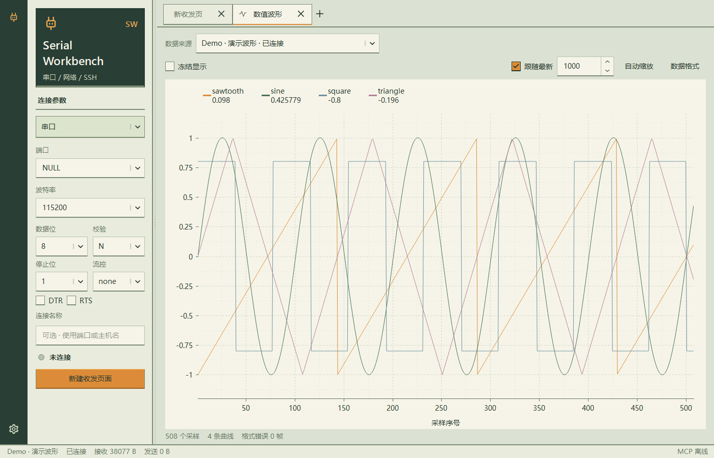
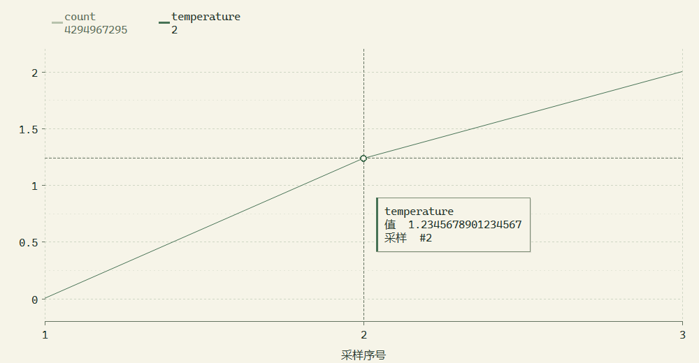
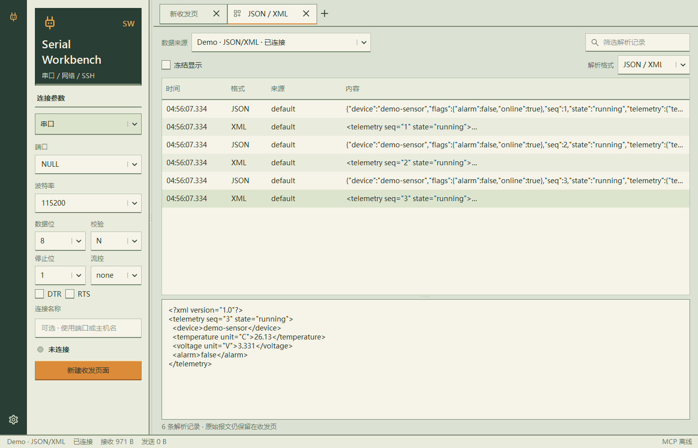

<!-- SPDX-License-Identifier: Apache-2.0 -->

# Serial Workbench

一个面向嵌入式开发的 Windows 串口、网络与 SSH 调试助手。人在界面查看数据，Codex、Claude、OpenCode、Pi Agent 等 AI 通过 MCP 同时读取同一份数据，无需再次打开串口。

当前版本：0.15.9。Qt 6 / C++17 原生应用。桌面程序和 STDIO 桥均不依赖 Python 运行时。

## 功能概览

- **连接调试**：串口、TCP 客户端/服务端、UDP 与 SSH，多连接分别保留参数和视图。
- **收发与终端**：文本/HEX、ANSI 终端、搜索、自动换行、定时发送及日志导出。
- **数据控件**：独立标签中的数值波形、实时数值和 JSON/XML，可共享同一个连接。
- **串口文件传输**：原始字节与 XMODEM-CRC，支持发送、接收、进度、速率、剩余时间和取消。
- **自定义协议**：C 风格脚本处理串口原始字节，自行分帧与校验，结果独立展示在收发页。
- **AI 协作**：MCP HTTP 与 STDIO 共享当前会话，界面和多个 AI 客户端各自读取历史；写操作由权限开关控制。


采用灰绿面板、深绿侧栏和琥珀色强调。标题使用 Segoe UI，菜单、参数和说明使用微软雅黑 UI，收发数据采用等宽字体。工具栏统一使用矢量线条图标，鼠标悬停显示功能提示；图标悬停时轻微抬起，按下时下沉，设置齿轮在鼠标移入和移出时各转一整圈。输入框、按钮和菜单通过细边线与局部底边表现状态。设置中可选择浅色或深色主题，单独调整数据字体、字号或恢复推荐字体。
旧版默认点阵数据字体自动迁移，其他自选字体保留。

串口连接后，点击收发工具栏的文件传输图标，选择方向、协议和文件即可操作。设备端需要对应的接收或发送程序，详见 [串口文件传输](docs/serial-file-transfer.md)。测试 Demo 单独构建，不进入正式安装包。

## 启动

安装版文件名为 `SerialWorkbench-<版本>-windows-x64-setup.exe`。双击进入安装向导，可选择安装目录及桌面快捷方式。安装包带透明背景的浅绿色双折闪电图标，包含完整运行库和 MCP 桥，无需安装 Python 或 Qt。安装后通过桌面/开始菜单启动，也可直接运行安装目录中的 `SerialWorkbench.exe`。

同一 Windows 用户再次安装新版时，会自动读取旧安装目录并覆盖升级，安装向导默认使用原路径。

安装版配置保存在 `%LOCALAPPDATA%\SerialWorkbench\settings.json`，升级不会覆盖。卸载可使用 Windows「已安装的应用」、开始菜单的卸载项，或安装目录中的 `Uninstall.exe`。默认保留个人设置，也可在卸载界面勾选删除。卸载仅移除安装包自己的文件，保留自行放入安装目录的其他文件。程序或 MCP 桥运行时会提示先关闭再安装/卸载。

安装后打开「设置 → AI / MCP → Agent 接入」重新配置 Agent，STDIO 桥路径会指向所选安装目录。详见 [安装与卸载](docs/windows-installer.md)。

无需编译时，打开 [GitHub Releases](https://github.com/lilinng-163/serial-workbench/releases/latest)，下载 `SerialWorkbench-0.15.9-windows-x64-setup.exe`，双击安装。安装包包含完整 Qt / MinGW 运行库和原生 MCP 桥，可选择安装目录，提供卸载入口。Release 同时提供 `SHA256SUMS.txt` 校验文件。

[直接下载安装包](https://github.com/lilinng-163/serial-workbench/releases/download/v0.15.9/SerialWorkbench-0.15.9-windows-x64-setup.exe)。旧版单文件启动器及便携 ZIP 可从对应的历史 Release 获取。

双击根目录 `start.bat` 或 `scripts/start.bat` 启动原生版；也可直接运行 `dist/SerialWorkbenchNative/SerialWorkbench.exe`。

分发时复制整个 `SerialWorkbenchNative` 文件夹，保留 Qt DLL 和插件目录。`SerialWorkbenchMCP.exe` 是原生 STDIO 桥接程序。首次启动默认端口为 `NULL`，不会自动连接设备。端口自动检测插拔，下拉列表显示 COM 名称与设备描述；选中后显示制造商、USB VID/PID 和序列号，悬停可查看设备路径。设备未提供的信息自动省略。

```powershell
# 打开内置示例信号
.\dist\SerialWorkbenchNative\SerialWorkbench.exe --demo

# 自定义 MCP 端口
.\dist\SerialWorkbenchNative\SerialWorkbench.exe --mcp-port 8877
```

接收区默认自动换行，工具栏的折行箭头可切换。关闭后，长消息可通过底部横向滚动条查看；此选项会保存，且不改变原始数据或日志导出。

顶部标签旁的「＋」先选择「新建收发页面」或「新建控件页面」。收发页面左侧填写串口或网络参数，右侧直接显示接收区和发送栏，不再套一层「收发」标签。多个串口和网络连接可同时运行；每个草稿保留自己的参数和发送文本。连接标签显示名称与状态方块：绿色表示连接或监听，黄色表示连接或恢复中，灰色表示断开，红色表示出错；悬停查看详情。

鼠标中键点击收发或控件标签可关闭该页；关闭连接页会断开连接，关闭控件页保留数据源。标签可拖动排序，拖出标签栏会成为独立窗口，也可右键选择「移至独立窗口」。收发页面、控件页面以及设置中的标签均支持分离。拖动独立窗口的系统标题栏使用 Windows 11 吸附与分屏；悬停最大化按钮或按 Win + Z 选择系统布局。窄窗口会自动收起连接参数，点击左上角闪电图标可展开。

拖出的连接仍由同一个程序和 MCP 服务管理，不重复打开设备；连接 ID、发送草稿、控件状态和历史保持。独立工作台窗口右上角的返回图标、关闭独立窗口或将其系统标题栏拖回主标签栏，都可重新停靠；设置页面的独立窗口也可通过下方「返回标签栏」返回。关闭主工作台才结束全部连接；连接标签上的关闭按钮仍会停止并移除该连接。右键还可断开、重连、重命名连接名称、清屏和导出日志。切换或移动标签会停止该标签的循环发送。

「＋ → 新建控件页面」提供「数值波形」「实时数值」「JSON / XML」。控件和收发页面平级显示在同一条主标签栏；控件页保留左侧连接参数，在页内「数据来源」选择连接后，左侧同步显示该来源的参数，可直接断开、重连或调整串口参数。连接尚未创建时，左侧沿用收发草稿；建立连接后控件自动使用该来源。由收发页新建控件时默认使用该连接；尚未建立连接时也可先创建空控件。控件不重复打开设备，多个控件可读取同一份数据，独立冻结和拖出窗口。关闭控件不关闭连接，不清除共享历史。移除数据源后控件保留所选来源，等待同一连接重新建立。数值波形支持滚轮缩放、拖动平移、自动缩放及数据格式帮助。

拖动收发页中带握柄的分隔条调整接收区和发送栏高度，双击可均衡布局。收发比例、时间戳和终端模式按连接保存；控件页面的类型、数据来源、波形点数、冻结状态和解析格式单独保存。旧版本的连接内控件会迁移为主标签页，启动时不会自动打开设备。

左下角齿轮打开「设置」：「外观」内调整主题、数据字体和 8～32 字号；「AI / MCP」内查看连接总览、配置 AI 客户端、控制 AI 权限和查看调用日志。在收发、终端或发送内容中按 Ctrl + 滚轮也可同步调整字号。数据位、校验、停止位、流控和 DTR/RTS 直接显示在左侧。收发工具栏的时钟和 `0x` 图标分别控制时间戳和十六进制显示；搜索框内可直接筛选、清空关键词；跟随滚动、日志导出和循环发送直接使用图标控制。

窗口标题显示原生版本；MCP 的 `get_status` 返回同一进程的账户和进程信息。同一账户、同一 MCP 端口重复启动时，会唤醒已有窗口。同一窗口不能重复打开同一串口，界面和 AI 共同读取已有连接即可。

请从自己的 Windows 桌面双击启动程序。MCP 的进程信息可确认当前运行账户。MCP 端口无法监听时，底部状态栏会显示离线，悬停可查看原因；AI 此时可能连接的是其他窗口，请关闭旧窗口后重新启动，或指定不同的 `--mcp-port` 并同步修改 AI 客户端配置。

连接按钮上方的 LED 状态灯与当前连接同步：绿色表示已连接或监听中，黄色表示连接中或重连中，红色表示异常，灰色表示未连接或已断开。旁边同时显示状态文字，连接中的操作按钮可取消连接。

设置窗口可拖动边缘或右下角调整大小，也可最大化。外观与客户端列表在空间不足时滚动，连接总览和调用日志随窗口伸缩；关闭后保留设置窗口的尺寸与位置。

左侧连接参数栏可拖动右边缘调整宽度，字段随栏宽伸缩，关闭后保留设置。双击分隔线恢复默认宽度；分隔线获得键盘焦点后，左右键微调、Shift 加速、Home 恢复默认。窄窗口中的参数浮层也可调整宽度，隐藏后重新展开会沿用设置。

「关于」显示当前程序与 Qt 运行库版本，并按连接、收发终端、数据控件、标签窗口及 AI / MCP 分组介绍功能。文字可选中复制，窄窗口下自动换行并纵向滚动。

双击收发或控件标签可直接修改标签名；右键标签也有「重命名标签」。自定义名称在连接状态变化、标签切换及拖出窗口后继续显示。连接本身的名称可在左侧「连接名称」单独修改。

## 连接与报文

| 功能 | 使用方式 |
| --- | --- |
| 串口 | 自动检测设备插拔，列表与端口字段同步更新；端口只读，从实时列表选择；草稿端口移除后回到 NULL，已建立连接保留原 COM 等待恢复；波特率可直接编辑，范围 1～12000000，实际支持取决于设备和驱动 |
| 串口参数 | 5/6/7/8 数据位，N/E/O/M/S 校验，1/1.5/2 停止位，RTS/CTS 或 XON/XOFF 流控，初始 DTR/RTS |
| TCP 客户端 | 填写远端 IP/主机名和端口 |
| TCP 服务端 | 填写本地 IPv4 和端口；支持最多 16 个客户端，发送时可选择目标客户端 |
| UDP | 同时填写本地绑定地址和远端目标地址；可在发送栏指定另一个 `IP:端口` |
| SSH | 选择 `~/.ssh/config` 中的主机别名，或输入主机地址；用户名、端口和私钥文件留空时由系统 OpenSSH 配置决定。连接后自动进入交互终端 |
| 文本/HEX | UTF-8、GBK、ASCII、Latin-1；HEX 例如 `01 03 00 00 00 02 C4 0B` |
| 换行 | 显示 None、`LF · \n`、`CR · \r`、`CRLF · \r\n`；下拉菜单同时解释 Line Feed / Carriage Return。HEX 模式也会追加换行，发送二进制报文时通常选择「无换行」 |
| 定时发送 | 最小 20 ms；开启时固定当前连接、报文和周期，修改后重新勾选；切换连接或发生错误会停止 |
| 报文模板 | 保存当前报文、编码、HEX 和换行设置；可导入/导出 JSON，示例在 `examples/templates.json` |
| 日志 | 时间戳、方向、对端地址；文本自动拼接接收分块、解析 ANSI 颜色、合并 CRLF 换行；支持过滤、HEX、暂停显示、导出当前连接的保留历史为 JSONL |

串口已连接时，选择波特率或输入后移开焦点立即应用；数据位、校验、停止位、流控和 DTR/RTS 的修改也立即应用。状态栏显示驱动确认的实际波特率。Windows 通过 `GetCommState` 回读，驱动拒绝参数或回读不一致时会断开并明确报错。重新连接沿用已应用参数。软件回环不能验证实体 UART 的速率。TCP/UDP 默认绑定 `127.0.0.1`，局域网设备需要绑定本机局域网 IP 或 `0.0.0.0`。远端报文的应用协议内容由你自行构造，发送区不自动追加协议 CRC；接收端可在自定义帧脚本中检查 SUM8、XOR8 或 Modbus CRC16。

界面的端口字段只读，仅可选择 `NULL` 或实时发现的串口，不能输入、删除或改写端口名称。开发时可通过 MCP 的 `open_connection` 使用 `loop://` 测试软件回环。

Espressif USB Serial/JTAG（VID `303A` / PID `1001`）会显示 USB 速率提示。这是 USB 通道，改变 COM 波特率后仍能正常读取文本不意味着设置失败；其没有 UART 物理波特率。通过 USB 转 UART 桥测试时，波特率才需要与固件 UART 一致。参考 [Espressif 官方说明](https://docs.espressif.com/projects/esp-brookesia/en/latest/system/usb_cli.html)。

端口旁的「实时扫描」表示正在自动检测设备，无需点击刷新。列表展开时也会同步更新；设备移除后字段回到 `NULL`，已有连接的设备恢复与手动停止仍可使用。详情见 [实时端口发现](docs/live-ports.md)。

首次使用默认显示 `NULL`，表示尚未选择，不会尝试打开设备；之前保存的实体端口仍可用时才恢复，旧版保存的软件回环端口会重置为 `NULL`。

串口首次成功连接后，设备复位导致驱动读写失败时会进入「等待设备恢复」，持续重试原来的端口，恢复后自动接收。连接 ID、历史记录和 AI 的读取游标保持不变；手动断开会停止重试。设备暂时没有输出时仍保持连接。等待恢复期间保留原 COM 名称，按钮显示「停止重连」；同一次断开只提示一次，后台重试不刷屏。等待恢复期间禁止发送，失败的发送不会自动重放；首次打开端口失败时会提示错误，修改参数后可重新连接。此功能使用原来的 COM 端口，不跟踪设备更换 COM 编号的情况。

收发监视的文本视图按设备的换行组织日志，不会把分开到达的 `ESC`、颜色码或中文字符显示成多条消息；没有换行的提示符也会实时更新。CR、LF、CRLF 均显示为普通换行，日志时间采用该行首次接收的时间。监视和终端都支持 ANSI SGR 的 16 色、256 色、RGB 前景/背景色以及粗体、斜体、下划线和颜色复位；跨接收块的颜色码会拼接解析。HEX、导出的日志及 MCP `read_events` 保留原始字节和接收分块；需要还原精确字符时使用 `hex`，按流增量解码。

## 终端

SSH 使用 Windows 自带的 `ssh.exe`，沿用 `~/.ssh/config` 的 `HostName`、`User`、`Port`、`IdentityFile`、`ProxyJump` 等设置和现有密钥代理。打开左侧协议选择中的 SSH，选择别名后点击「建立连接」；程序会自动检测配置文件及 `Include` 文件的变化并更新主机列表。程序不会读取或保存私钥内容。SSH 连接只使用已配置的密钥或代理，不弹出密码输入框；若主机尚未加入 `known_hosts`，请先在系统终端执行一次 `ssh 主机别名` 完成主机验证。SSH 终端的输入不会写入共享日志，以免远端程序的密码输入进入日志；接收内容仍可由界面和 MCP 分别读取。

收发工具栏最左侧的终端图标在日志与交互终端之间切换，下方发送栏在终端模式隐藏。点击终端即可直接输入，闪烁光标显示设备的输入位置。按 Insert 或点击工具栏光标图标，在方块和竖线光标之间切换；Insert 仅改变本地光标形状，不向设备发送字符。再次点击终端图标返回收发日志与发送栏，共享历史保留。终端输入发送到当前终端所属的连接。

终端与 JSON/XML 解析可同时开启。恢复上次设置或调整解析格式时，终端保持显示；点击「JSON / XML」可查看解析结果，后台接收和解析继续运行。

终端使用 VT100/ANSI 解析器处理颜色、光标移动、回车、退格、清屏等控制序列，提供随窗口和字号调整行列的彩色字符终端。支持方向键、Home/End、PageUp/PageDown、Tab、Esc、Ctrl+C、Ctrl+D 和输入法提交文本；输入法候选窗跟随终端光标。输入使用 UTF-8，回车发送 CR，不做本地回显。拖动可选择终端文本，按 Ctrl+C 或 Ctrl+Shift+C 复制；Ctrl+Shift+V 粘贴，右键也可粘贴。工具栏剪贴板图标可分别开关复制快捷键、粘贴快捷键和右键粘贴；Ctrl+C 在没有选区时仍发送给远端程序，Ctrl+V 保留为终端控制键。接收编码跟随发送栏的编码选择，建议选择等宽字体。时间戳仅用于收发监视，终端保持设备原始屏幕布局。

终端是所选连接的接收视图，不是本地 PowerShell。收发监视仍保留原始数据。TCP 服务端有多个客户端时，终端显示它们汇总的接收流，键盘发送按目标客户端选择；需要独立终端时使用单独连接。

## 波形

波形与实时数值仅识别 **wave/1 专用协议**。每个采样独占一行，以小写 `@wave ` 开头，以 CR、LF 或 CRLF 结束：

```text
@wave count=120,temperature=25.50,voltage=3.300
```

字段名就是通道名，顺序变化不影响归属。每帧支持 1～16 个命名通道，整数、负数、浮点数和科学计数法可混合；例如 `@wave count=123,temperature=-12.5,current=1.25e-3`。名称可用字母、汉字、数字和下划线，不能以数字开头，最长 64 个字符，同帧不得重名。

```c
printf("@wave count=%d,temperature=%.2f,voltage=%.3f\r\n",
       count, (double)temperature, (double)voltage);
```

没有前缀的数字、CSV、JSON、普通日志和脚本输出不会进入波形或实时数值。带前缀但字段格式错误的报文整帧丢弃，不生成部分通道采样；普通日志不计入格式错误。详细语法、精度、分包处理及旧格式迁移见 [波形专用协议](docs/wave-protocol.md)。

支持串口、TCP 和 UDP。接收分块自动拼接，不同网络发送方独立处理；每帧最多 8192 字节，每个来源保留最近 5000 个采样，界面最多显示 16 条曲线。横轴为采样序号，纵轴为设备发送的数值，MCP 同时返回主机接收时间。支持冻结、滚轮缩放、拖动平移、曲线图例和自动缩放。

波形页「数据来源 → Demo · 演示波形」可直接预览，无需连接设备或使用命令行。内置正弦波、三角波、方波和锯齿波，启动时预填 500 个采样，再以 50 Hz 持续生成。支持冻结、缩放、平移、隐藏通道和精确读数；切回设备连接即可查看真实数据。多个控件共享一份 Demo，Demo 不占用实体端口，不额外创建收发标签，且为只读数据源。选择会随控件页面保存。

本地 0.15.5 的波形页使用独立的 16 ms 刷新定时器，只同步新增采样；数据没有变化时复用绘制缓存。曲线使用快速抗锯齿细线绘制；密集曲线按屏幕列保留最小值和最大值，保留短脉冲，原始采样和 MCP 读数不变。实际帧率取决于设备发送频率、窗口尺寸和机器负载。

顶部通道图例显示各通道的最新数值，点击可隐藏或显示曲线，纵轴随可见通道重新缩放。计数器数值很大时，可以先隐藏它，再观察温度、电压等小范围曲线。图例横向滚动，完整数值不使用省略号。

移动鼠标出现十字线和读数卡，显示最近的原始采样通道、采样序号与数值；读数保留 double 可往返还原的有效数字。绘图区按 Ctrl+C 或右键「复制当前读数」可复制 JSON，右键还可复制全部通道最新值。需要稳定检查时先勾选「冻结显示」。





固件每 500 ms 发送一次只会产生每秒 2 个新采样。希望曲线更连续时，可单独把 `@wave` 报文周期调整为 10～20 ms，普通日志、JSON/XML 维持较慢周期；需确保总发送量不超过串口实际吞吐。渲染不会凭空补出设备未发送的采样。[本地性能验证](docs/waveform-performance-local.md)记录了测试场景、耗时和复现方法。

滚轮围绕鼠标位置缩放双轴；Shift + 滚轮只调整横轴，Ctrl + 滚轮只调整纵轴，也可直接在对应坐标轴上滚动。刻度间距随可见范围及窗口宽度调整；采用较密的主、次虚线网格，半格细分只显示网格线，数字标在主刻度，窄窗口自动减少标签密度。按住左键可上下左右平移，即使完整显示全部采样也能拖动。

拖动或横轴缩放后，「跟随最新」自动取消，后续数据继续接收但不会推走正在查看的范围。重新勾选只把当前窗口平移到最新采样，保留调好的横轴跨度与纵轴范围；后续采样继续以同一比例滚动。双击绘图区或点击「自动缩放」才会恢复双轴完整范围和跟随状态。采样上限框只显示数字，其上限与屏幕缩放分别控制历史保留量和可见范围。

本工具显示设备按协议发送的数值，不测量 UART 物理电平。

## AI 接入

先启动桌面程序。默认 MCP 地址为 `http://127.0.0.1:8765/mcp`，使用标准 Streamable HTTP。左下角齿轮「设置 → AI / MCP」提供可复制配置；端口变化后这里会同步更新。

「连接总览」页显示各连接的协议、状态、连接 ID 和收发计数；连接详情中的 `peers` 提供 TCP 对端。AI 的 `get_status` 返回同一份总览；`read_events` 不指定 `channel_id` 可读取全部连接，指定后读取单个连接。界面当前选中的标签不会限制 AI 访问其他连接。

「Agent 接入」页按两列展示 Codex、Claude Code、Claude Desktop、OpenCode CLI、Pi、Hermes、OpenClaw、Grok Build、Gemini CLI。检测 Windows PATH、常见安装目录与注册的桌面应用；仅已检测到安装的客户端可以配置和检查。残留的配置文件不视为安装。WSL、远程机器和容器中的 Agent 不在 Windows 本机扫描范围内。

监听端口可以手动修改，也可以点击「自动选空闲」。新端口不可用时保留原监听；应用成功后立即保存，并更新显示的地址。默认启动时读取保存的端口，遇到占用自动选取空闲端口；显式 `--mcp-port` 保持指定端口。切换端口保留串口连接、历史和 MCP 会话数据，Agent 需重新连接新地址。

点击「一键更新已安装 Agent」把新地址同步到全部已检测到的客户端。每个客户端独立报告结果；一个失败不会阻止其他客户端更新。也可以单独「配置」或只读「检查」。写入前备份 `.bak`，保留其他 MCP 服务与注释，校验 JSON/JSONC、常见 JSON5、TOML 和 YAML；遇到不支持的特殊写法拒绝修改并提示。检查包含实际 HTTP 初始化握手和配置地址检查，不代表已完成 Agent 对话。更新后重载 Agent 配置；Pi 使用 `/reload`。Claude Desktop 使用同目录的 `SerialWorkbenchMCP.exe` 桥接，其他客户端通过 HTTP 接入。详见 [Agent 配置与官方参考](docs/agent-integration.md)。

「调用日志」显示客户端名称、工具、成功/失败、耗时及错误。名称来自 MCP 客户端会话，日志保留最近 1000 次调用，发送内容仅在后台摘要中记录长度。

### Codex

```powershell
codex mcp add serial-workbench --url http://127.0.0.1:8765/mcp
```

也可以在 `~/.codex/config.toml` 中加入：

```toml
[mcp_servers.serial-workbench]
url = "http://127.0.0.1:8765/mcp"
```

参考 [Codex 官方 MCP 文档](https://developers.openai.com/codex/mcp)。

### Claude Code

```powershell
claude mcp add --transport http serial-workbench http://127.0.0.1:8765/mcp
```

参考 [Claude Code 官方 MCP 文档](https://code.claude.com/docs/en/mcp)。

### OpenCode CLI

将下面的 `mcp` 项合并到 `opencode.json` 或 `opencode.jsonc`，保留已有的其他配置：

```json
{
  "$schema": "https://opencode.ai/config.json",
  "mcp": {
    "serial-workbench": {
      "type": "remote",
      "url": "http://127.0.0.1:8765/mcp",
      "enabled": true
    }
  }
}
```

参考 [OpenCode 官方 MCP 文档](https://opencode.ai/docs/mcp-servers/)。`remote` 表示 HTTP 传输方式，即使服务运行在本机也使用该配置。

### Claude Desktop / STDIO 客户端

使用随项目提供的 STDIO 桥，它转发到正在运行的桌面程序，所有客户端仍共享同一个接收源。可从界面复制适合当前安装目录的配置：

```json
{
  "mcpServers": {
    "serial-workbench": {
      "command": "E:/demo/serial/dist/SerialWorkbenchNative/SerialWorkbenchMCP.exe",
      "args": [
        "--url",
        "http://127.0.0.1:8765/mcp"
      ]
    }
  }
}
```

配置完成后重新加载客户端 MCP 服务。STDIO 桥不会自行启动桌面程序。以上配置需要在 Windows 本机客户端运行；WSL、容器、远程电脑或云端客户端中的 `127.0.0.1` 不等于 Windows 桌面所在机器。

### 可以对 AI 这样说

> 使用 serial-workbench 列出连接，读取我打开的串口数据，帮我分析最近的启动日志。之后使用 next_cursor 继续读取，不要重复分析旧数据。

> 读取 temperature 和 voltage 的波形样本，计算范围，找出异常值。

> 我已在界面允许 AI 控制，请向指定连接发送 HEX `01 03 00 00 00 02 C4 0B`，不要追加换行，然后读取响应。

首次启动默认所有 AI 只能读取。开启「允许 AI 发送报文和控制连接」后可发送、打开和关闭连接；此设置立即保存，下次启动恢复上次状态，对所有接入客户端生效。MCP 仅监听本机回环地址，不启用登录鉴权；本机能够访问该端口的程序均可读取保留数据。

## 共享读取与 MCP 工具

```text
串口 / TCP / UDP → Qt 异步接收 → 有界历史记录
                                  ├─ 界面游标
                                  ├─ Codex 游标
                                  ├─ Claude 游标
                                  └─ OpenCode 游标
```

| 工具 | 作用 |
| --- | --- |
| `get_status` | 全部连接、各协议在线数量、恢复中数量、会话 ID、当前游标、权限、缓冲区限制 |
| `list_serial_ports` | 本机串口列表，不打开端口 |
| `list_connections` | 连接 ID、参数、状态、字节计数、TCP 对端 |
| `read_events` | 按游标独立读取收发和状态记录，支持最长 10 秒等待 |
| `read_waveform` | 仅读取 wave/1 专用报文形成的数值采样及时间戳 |
| `read_structured` | 读取启用解析后的 JSON/XML 记录，各来源有独立游标 |
| `read_script_results` | 独立读取收发页的自定义帧脚本结果，与波形及 JSON/XML 游标分开 |
| `send_data` | 发送文本或 HEX，需允许 AI 控制 |
| `open_connection` | 异步建立连接，随后查询连接状态，需允许 AI 控制 |
| `close_connection` | 断开连接，历史保留，需允许 AI 控制 |

`read_events(after=0, limit=200, channel_id=..., wait_ms=5000)` 返回 `events`、`next_cursor`、`has_more`、`session_id`、`gap` 等字段。每个读者独立保存 `next_cursor`，作为下次 `after`。不同连接筛选也应各自保存游标。应用重启后 `session_id` 改变，读者应把游标重置为 0。

接收历史最多保留 20000 条记录或 8 MiB JSON 编码数据，先达到哪个限制就淘汰最旧记录。慢读者遇到覆盖时 `gap=true`，不会假装提供完整历史。历史仅在内存中，退出后不保留；需要保存时使用日志导出。清屏只改变界面显示，AI 历史不受影响。

`hex` 是准确的原始字节；`text` 是单个接收块的 UTF-8 预览，多字节字符跨块时应拼接 `hex` 后增量解码。TCP/串口的每条记录是一次读取的字节块，不代表设备协议帧边界；UDP 保留数据报边界。需要帧解析时根据自身协议的长度、分隔符或 CRC 处理。

串口恢复时会新增带有 `stream_reset=true` 的状态记录，增量解码器和报文拼接器应在此处重置，避免把复位前的半条消息拼到新启动日志上。`list_connections` 的 `serial_generation` 表示成功打开串口的次数，`reconnect_attempts` 表示恢复尝试次数；等待期间状态为 `reconnecting`，恢复后为 `connected`。

可运行 `examples/read_mcp.py` 查看一个独立 MCP 读者示例。原生服务实现 MCP Streamable HTTP JSON 响应，STDIO 桥转发到同一个进程；打包测试使用 [官方 MCP Python SDK](https://github.com/modelcontextprotocol/python-sdk) 验证。

## JSON / XML 提取

页内「数据来源 → Demo · JSON/XML」提供独立的结构化演示：每秒生成一组 JSON 对象与 XML 报文，包含温度、电压、设备状态和布尔标志，选择后立即显示示例。此页不列出波形 Demo；波形页也不列出 JSON/XML Demo。实体连接仍可同时发送多种报文，由各控件独立解析。



通过「＋ → 新建控件页面 → JSON / XML」添加解析页，在页内格式选项中选择「JSON / XML」「仅 JSON」或「仅 XML」，程序开始从后续接收流中提取完整对象。支持日志前后混有普通文本、JSON 嵌套对象/数组、多行与跨接收块、XML 嵌套元素/属性/CDATA；ANSI 颜色码不影响解析。JSON 顶层需要是对象或数组。

「JSON / XML」页列出提取记录，选择一条查看格式化内容；格式选择和文本过滤共同筛选显示。原始收发区、HEX、导出日志及 MCP `read_events` 始终保留原数据，解析不会消耗它们。不同网络对端分别拼接，不会把两个来源合成一条消息。

`read_structured(channel_id=..., cursors={"default":0}, limit=100)` 返回 `sources`。每个来源包含 `records`、`next_cursor`、`gap` 和 `has_more`；下次传入各来源的游标。记录中的 `event_seq` 关联原始接收记录，JSON 同时提供解析后的 `value`；XML 提供原文及格式化文本。复位恢复会丢弃未完成片段，保留已解析记录。

解析默认关闭，不追溯开启前的数据。每个来源最多保留 500 条或 2 MiB 记录，未完成文本上限 65536 字符、嵌套上限 128 层。无效完整消息会跳过，超长片段会截断；XML 不加载外部资源或 DTD。结构化页最多显示最近 200 条。需要严格协议分帧时，仍应依据自身报文格式处理原始数据。

## 自定义帧脚本

串口会话的左侧连接参数区提供「脚本解析」和代码编辑图标。编写固定入口 `void main(const uint8_t data[], int length)`，启用开关后处理新收到的原始字节。TCP、UDP、SSH 和演示会话不提供脚本入口。脚本提供跨接收批次的缓存、大小端整数与浮点读取、SUM8 / XOR8 / Modbus CRC16 校验；`emit("字段名", 数值)` 的结果显示在收发页的「脚本解析」小分区，可拖动调整高度、收起、复制与清空显示。原始收发日志保持完整，AI 通过 MCP `read_script_results` 主动读取脚本输出；读取无需开启 AI 写权限。

波形和实时数值仅识别 `@wave name=value,...` 专用文本行；JSON / XML 控件独立提取对应格式。启用脚本不会关闭这些解析器，脚本字段也不会进入它们的结果。同一串口可交替发送自定义帧、完整波形文本行和日志，分别展示。

编辑器带行号、高亮、语法检查、HEX 试解析及脚本导入导出。每行 HEX 模拟一次接收，可验证半帧与连续多帧。脚本在后台执行，越界、死循环或缓存超限会停用解析并提示行号，连接继续运行。代码和开关按连接保存；程序启动时不自动连接设备。

这是限定的 C 风格语法子集，支持 `if / else`、`for / while`、数值变量、`static`、类型转换和位运算。用法、完整函数与限制见 [自定义帧脚本](docs/frame-scripts.md)，可导入 [示例脚本](examples/frame-parser.c)。


## 开发与打包

需要 Qt 6（Widgets、Network、SerialPort、Core5Compat、Test）、CMake、Ninja 和对应的 C++17 编译器。当前构建使用 Qt 6.11.1 / MinGW 13.1 / Release。可在脚本参数中调整本机工具链路径。

```powershell
# 配置、编译、原生测试、部署 Qt 运行库
# 配置本机工具链，也可使用脚本的 -QtRoot / -CompilerBin 参数
$env:QTDIR = 'D:/lib/Qt/6.11.1/mingw_64'
$env:MINGW_BIN = 'D:/lib/Qt/Tools/mingw1310_64/bin'
.\scripts\build.ps1

# 打包后的 HTTP / STDIO 集成测试，需要 Python MCP SDK
python -m venv .venv
.\.venv\Scripts\python.exe -m pip install -r tests/integration/requirements.txt
.\.venv\Scripts\python.exe tests/integration/smoke_native.py --expected-version 0.15.9
```

测试覆盖独立读取与分页、真实 TCP/UDP socket、软件串口回环及重配置、UTF-8/GBK 分片解析、ANSI 颜色与终端、连接标签和布局、设置恢复、MCP HTTP/STDIO、权限、非阻塞等待和错误参数。实际 COM 硬件、USB 设备的实际线速及各 AI 客户端的完整对话需要在对应环境验证。

### 生成 Release 下载包

先使用构建脚本生成 `dist/SerialWorkbenchNative`，再使用 NSIS 制作单文件启动器。传入当前 Qt 版本的源码目录，用于收集模块及第三方许可证：

```powershell
.\scripts\package-release.ps1 -QtSourceRoot 'D:/lib/Qt/6.11.1/Src' -MakeNSIS makensis
.\.venv\Scripts\python.exe tests/integration/smoke_release.py --expected-version 0.15.9
```

产物位于 `dist/releases/`，包含安装包、单文件 EXE、便携 ZIP 和 SHA-256 校验文件。`-InstallerOnly` 可仅生成安装包。打包仅复制程序、运行库、插件与许可证，排除本机 `settings.json` 及其备份。发布包测试在不含 Qt SDK 的 PATH 下验证便携版、单文件首次与缓存启动、Unicode 路径、参数传递及 HTTP/STDIO 共享会话。

工程按职责组织：`src/app/` 为桌面入口，`src/core/` 为连接与数据处理，`src/mcp/` 为共享 MCP 服务，`src/ui/` 为界面与控件，`src/bridge/` 为 STDIO 桥。资源在 `resources/`，构建脚本在 `scripts/`，测试在 `tests/`，CMake 公共规则在 `cmake/`。构建产物仅放入 `build/`，分发产物放入 `dist/`。详细目录、CMake 目标和手动构建方式见 [工程结构](docs/project-structure.md)。

便携版的程序目录 `settings.json`、安装版的用户配置文件保存表单、模板、外观、各连接视图及 AI 权限，启动时不自动打开设备。

主题与字体规则、参考设计见 [像素主题说明](docs/pixel-theme.md)。独立窗口及 Windows 11 布局实现验证见 [0.8.0 验证记录](docs/workspace-0.8-validation.md)。

旧 Python 实现及其测试、依赖和打包脚本完整归档至 [legacy/python](legacy/python/README.md)。历史打包版仍位于 `dist/SerialWorkbench/`，供回退使用；Python 0.6.0 基线提交为 `7e74c8c`。

## 许可证

项目自有源码采用 [Apache License 2.0](LICENSE)，标识为 `SPDX-License-Identifier: Apache-2.0`。

第三方依赖及资源遵循各自许可证：Qt 按所使用版本及模块的许可分发；随程序保留的点阵字体许可位于 [resources/fonts](resources/fonts/README.md)。便携包包含项目许可证和字体许可文件，分发时请保留这些文件。

波形工具栏的「X 轴」「Y 轴」分别控制刻度与标签，隐藏后绘图区自动扩大；网格、曲线、悬停数值和缩放拖动保持可用。每个波形页独立保存这两个开关。
