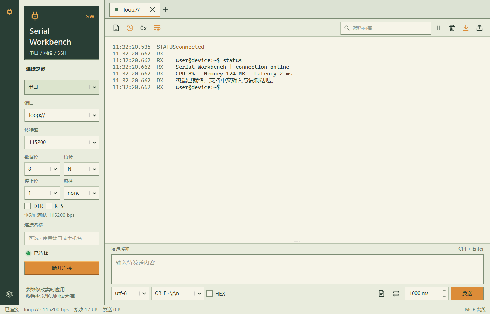

# Serial Workbench

一个面向嵌入式开发的 Windows 串口与网络调试助手。人在界面查看数据，Codex、Claude、OpenCode 等 AI 通过 MCP 同时读取同一份数据，无需再次打开串口。

当前版本：0.10.2，Qt 6 / C++17 原生应用。桌面程序和 STDIO 桥均不依赖 Python 运行时。



默认采用「像素掌机」主题：灰绿面板、深绿侧栏和琥珀按键。菜单、参数和说明采用平滑的微软雅黑 UI，收发数据采用等宽字体。像素字体仅保留在品牌标题，
让像素风与长时间阅读兼顾。设置中可选择浅色或深色，单独调整数据字体、字号或恢复推荐字体。
旧版默认点阵数据字体自动迁移，其他自选字体保留。

## 启动

双击根目录 `start.bat` 或 `scripts/start.bat` 启动原生版；也可直接运行 `dist/SerialWorkbenchNative/SerialWorkbench.exe`。

分发时复制整个 `SerialWorkbenchNative` 文件夹，保留 Qt DLL 和插件目录。`SerialWorkbenchMCP.exe` 是原生 STDIO 桥接程序。首次启动默认端口为 `NULL`，不会自动连接设备。

```powershell
# 打开内置示例信号
.\dist\SerialWorkbenchNative\SerialWorkbench.exe --demo

# 自定义 MCP 端口
.\dist\SerialWorkbenchNative\SerialWorkbench.exe --mcp-port 8877
```

顶部连接标签旁的「＋」快速新建连接，左侧填写串口或网络参数，右侧默认显示收发页。多个串口和网络连接可同时运行；每个草稿保留自己的参数和发送文本。连接标签显示名称与状态方块：绿色表示连接或监听，黄色表示连接或恢复中，灰色表示断开，红色表示出错；悬停查看详情。

标签可拖动排序，拖出标签栏会成为独立窗口，也可右键选择「移至独立窗口」。连接、收发页、各控件以及设置中的标签均支持分离。拖动独立窗口的系统标题栏使用 Windows 11 吸附与分屏；悬停最大化按钮或按 Win + Z 选择系统布局。窄窗口会自动收起连接参数，点击左上角端口图标可展开。

拖出的连接仍由同一个程序和 MCP 服务管理，不重复打开设备；连接 ID、发送草稿、控件状态和历史保持。独立连接窗口右上角的返回图标、页面窗口下方「返回标签栏」、关闭独立窗口或将其系统标题栏拖回对应标签栏，都可重新停靠。关闭主工作台才结束全部连接；连接标签上的关闭按钮仍会停止并移除该连接。右键还可断开、重连、重命名、清屏和导出日志。切换或移动标签会停止该标签的循环发送。

控件标签栏右端的网格加号图标提供二级菜单：「图表 → 数值波形」「数据 → 实时数值」「数据 → JSON / XML」。选择后在当前连接内添加独立控件标签页，收发页保留完整空间；波形和实时数值可添加多个实例，每个实例独立冻结。拖出的控件在切换连接后仍持续显示数据。关闭控件标签不关闭连接，不清除共享历史。数值波形支持滚轮缩放、拖动平移、自动缩放及数据格式帮助。

拖动收发页中带握柄的分隔条调整接收区和发送栏高度，双击可均衡布局。控件列表、波形点数、收发比例、时间戳、终端模式和解析格式按连接保存；打开连接时默认回到收发页。

左下角齿轮打开「设置」：「外观」内调整主题、数据字体和 8～32 字号；「AI / MCP」内查看连接总览、配置 AI 客户端、控制 AI 权限和查看调用日志。在收发、终端或发送内容中按 Ctrl + 滚轮也可同步调整字号。数据位、校验、停止位、流控和 DTR/RTS 直接显示在左侧。收发工具栏的时钟和 `0x` 图标分别控制时间戳和十六进制显示；搜索框内可直接筛选、清空关键词；「更多」保留跟随滚动和导出日志。

窗口标题显示原生版本；MCP 的 `get_status` 返回同一进程的账户和进程信息。同一账户、同一 MCP 端口重复启动时，会唤醒已有窗口。同一窗口不能重复打开同一串口，界面和 AI 共同读取已有连接即可。

请从自己的 Windows 桌面双击启动程序。MCP 的进程信息可确认当前运行账户。MCP 端口无法监听时，底部状态栏会显示离线，悬停可查看原因；AI 此时可能连接的是其他窗口，请关闭旧窗口后重新启动，或指定不同的 `--mcp-port` 并同步修改 AI 客户端配置。

## 连接与报文

| 功能 | 使用方式 |
| --- | --- |
| 串口 | 自动检测设备插拔，列表与端口字段同步更新；设备移除后回到 NULL，扫描不打断手动输入；波特率可直接编辑，范围 1～12000000，实际支持取决于设备和驱动 |
| 串口参数 | 5/6/7/8 数据位，N/E/O/M/S 校验，1/1.5/2 停止位，RTS/CTS 或 XON/XOFF 流控，初始 DTR/RTS |
| TCP 客户端 | 填写远端 IP/主机名和端口 |
| TCP 服务端 | 填写本地 IPv4 和端口；支持最多 16 个客户端，发送时可选择目标客户端 |
| UDP | 同时填写本地绑定地址和远端目标地址；可在发送栏指定另一个 `IP:端口` |
| 文本/HEX | UTF-8、GBK、ASCII、Latin-1；HEX 例如 `01 03 00 00 00 02 C4 0B` |
| 换行 | 显示 None、`LF · \n`、`CR · \r`、`CRLF · \r\n`；下拉菜单同时解释 Line Feed / Carriage Return。HEX 模式也会追加换行，发送二进制报文时通常选择「无换行」 |
| 定时发送 | 最小 20 ms；开启时固定当前连接、报文和周期，修改后重新勾选；切换连接或发生错误会停止 |
| 报文模板 | 保存当前报文、编码、HEX 和换行设置；可导入/导出 JSON，示例在 `examples/templates.json` |
| 日志 | 时间戳、方向、对端地址；文本自动拼接接收分块、解析 ANSI 颜色、合并 CRLF 换行；支持过滤、HEX、暂停显示、导出当前连接的保留历史为 JSONL |

串口已连接时，选择波特率或输入后移开焦点立即应用；数据位、校验、停止位、流控和 DTR/RTS 的修改也立即应用。状态栏显示驱动确认的实际波特率。Windows 通过 `GetCommState` 回读，驱动拒绝参数或回读不一致时会断开并明确报错。重新连接沿用已应用参数。软件回环不能验证实体 UART 的速率。TCP/UDP 默认绑定 `127.0.0.1`，局域网设备需要绑定本机局域网 IP 或 `0.0.0.0`。远端报文的应用协议内容由你自行构造，首版不包含 MQTT、Modbus 专用解析器或自动 CRC 计算。

开发时可手动输入 `loop://` 测试软件回环；默认端口列表仅包含 `NULL` 和发现的串口。

Espressif USB Serial/JTAG（VID `303A` / PID `1001`）会显示 USB 速率提示。这是 USB 通道，改变 COM 波特率后仍能正常读取文本不意味着设置失败；其没有 UART 物理波特率。通过 USB 转 UART 桥测试时，波特率才需要与固件 UART 一致。参考 [Espressif 官方说明](https://docs.espressif.com/projects/esp-brookesia/en/latest/system/usb_cli.html)。

端口旁的「实时扫描」表示正在自动检测设备，无需点击刷新。列表展开时也会同步更新；设备移除后字段回到 `NULL`，已有连接的设备恢复与手动停止仍可使用。详情见 [实时端口发现](docs/live-ports.md)。

首次使用默认显示 `NULL`，表示尚未选择，不会尝试打开设备；之前保存的实体端口仍可用时才恢复，旧版保存的软件回环端口会重置为 `NULL`。

串口首次成功连接后，设备复位导致驱动读写失败时会进入「等待设备恢复」，持续重试原来的端口，恢复后自动接收。连接 ID、历史记录和 AI 的读取游标保持不变；手动断开会停止重试。设备暂时没有输出时仍保持连接。等待恢复期间保留原 COM 名称，按钮显示「停止重连」；同一次断开只提示一次，后台重试不刷屏。等待恢复期间禁止发送，失败的发送不会自动重放；首次打开端口失败时会提示错误，修改参数后可重新连接。此功能使用原来的 COM 端口，不跟踪设备更换 COM 编号的情况。

收发监视的文本视图按设备的换行组织日志，不会把分开到达的 `ESC`、颜色码或中文字符显示成多条消息；没有换行的提示符也会实时更新。CR、LF、CRLF 均显示为普通换行，日志时间采用该行首次接收的时间。监视和终端都支持 ANSI SGR 的 16 色、256 色、RGB 前景/背景色以及粗体、斜体、下划线和颜色复位；跨接收块的颜色码会拼接解析。HEX、导出的日志及 MCP `read_events` 保留原始字节和接收分块；需要还原精确字符时使用 `hex`，按流增量解码。

## 终端

收发工具栏最左侧的终端图标在日志与交互终端之间切换，下方发送栏在终端模式隐藏。点击终端即可直接输入，闪烁光标显示设备的输入位置。按 Insert 或点击工具栏光标图标，在方块和竖线光标之间切换；Insert 仅改变本地光标形状，不向设备发送字符。再次点击终端图标返回收发日志与发送栏，共享历史保留。终端输入发送到当前终端所属的连接。

终端与 JSON/XML 解析可同时开启。恢复上次设置或调整解析格式时，终端保持显示；点击「JSON / XML」可查看解析结果，后台接收和解析继续运行。

终端使用 VT100/ANSI 解析器处理颜色、光标移动、回车、退格、清屏等控制序列，提供随窗口和字号调整行列的彩色字符终端。支持方向键、Tab、Esc、Ctrl+C、Ctrl+D、粘贴和输入法提交文本；输入使用 UTF-8，回车发送 CR，不做本地回显。接收编码跟随发送栏的编码选择，建议选择等宽字体。时间戳仅用于收发监视，终端保持设备原始屏幕布局。

终端是所选连接的接收视图，不是本地 PowerShell。收发监视仍保留原始数据。TCP 服务端有多个客户端时，终端显示它们汇总的接收流，键盘发送按目标客户端选择；需要独立终端时使用单独连接。

## 波形

数值数据按 LF 分行，可使用 CRLF，支持以下格式，每行最多 16 个数值：

```text
1.2,3.4,5.6
temperature=25.6,voltage=3.3
{"temperature":25.6,"voltage":3.3}
[1.2,3.4,5.6]
```

支持串口、TCP 和 UDP。流式数据跨接收块时自动拼接；网络不同发送方分别解析。每个发送方保留最近 5000 个采样，界面最多显示 16 条曲线。横轴是采样序号，纵轴是报文中的数值；MCP 同时返回主机接收时间。冻结、滚轮缩放、拖动平移、图例切换和自动缩放均可使用。

非数值日志会被忽略并计数。原始二进制数据仍可显示、导出和被 MCP 读取，但不自动转换成波形；设备需输出上面的逐行数值格式。本工具不是直接测量 UART 电平时序的逻辑分析仪。

## AI 接入

先启动桌面程序。默认 MCP 地址为 `http://127.0.0.1:8765/mcp`，使用标准 Streamable HTTP。左下角齿轮「设置 → AI / MCP」提供可复制配置；端口变化后这里会同步更新。

「连接总览」页显示各连接的协议、状态、连接 ID 和收发计数；连接详情中的 `peers` 提供 TCP 对端。AI 的 `get_status` 返回同一份总览；`read_events` 不指定 `channel_id` 可读取全部连接，指定后读取单个连接。界面当前选中的标签不会限制 AI 访问其他连接。

「客户端接入」页为 Codex、Claude Code、OpenCode CLI 和 Claude Desktop 分别提供「配置并检查」。按钮将本服务合并到当前 Windows 账户的客户端配置，保留其他设置，修改前生成带时间戳的 `.bak` 备份。OpenCode JSONC 的注释与其他服务器保留。随后检查本地服务、工具数量和 `get_status`；客户端需重启或重新加载配置。打包集成测试另行验证真实 HTTP / STDIO 传输。此检查不启动 AI 对话，也不会打开串口。

「调用日志」显示客户端名称、工具、成功/失败、耗时及错误。名称来自 MCP 客户端会话，日志保留最近 1000 次调用，发送内容仅在后台摘要中记录长度。

### Codex

```powershell
codex mcp add serial-workbench --url http://127.0.0.1:8765/mcp
```

也可以在 `~/.codex/config.toml` 中加入：

```toml
[mcp_servers.serial-workbench]
url = "http://127.0.0.1:8765/mcp"
```

参考 [Codex 官方 MCP 文档](https://developers.openai.com/codex/mcp)。

### Claude Code

```powershell
claude mcp add --transport http serial-workbench http://127.0.0.1:8765/mcp
```

参考 [Claude Code 官方 MCP 文档](https://code.claude.com/docs/en/mcp)。

### OpenCode CLI

将下面的 `mcp` 项合并到 `opencode.json` 或 `opencode.jsonc`，保留已有的其他配置：

```json
{
  "$schema": "https://opencode.ai/config.json",
  "mcp": {
    "serial-workbench": {
      "type": "remote",
      "url": "http://127.0.0.1:8765/mcp",
      "enabled": true
    }
  }
}
```

参考 [OpenCode 官方 MCP 文档](https://opencode.ai/docs/mcp-servers/)。`remote` 表示 HTTP 传输方式，即使服务运行在本机也使用该配置。

### Claude Desktop / STDIO 客户端

使用随项目提供的 STDIO 桥，它转发到正在运行的桌面程序，所有客户端仍共享同一个接收源。可从界面复制适合当前安装目录的配置：

```json
{
  "mcpServers": {
    "serial-workbench": {
      "command": "E:/demo/serial/dist/SerialWorkbenchNative/SerialWorkbenchMCP.exe",
      "args": [
        "--url",
        "http://127.0.0.1:8765/mcp"
      ]
    }
  }
}
```

配置完成后重新加载客户端 MCP 服务。STDIO 桥不会自行启动桌面程序。以上配置需要在 Windows 本机客户端运行；WSL、容器、远程电脑或云端客户端中的 `127.0.0.1` 不等于 Windows 桌面所在机器。

### 可以对 AI 这样说

> 使用 serial-workbench 列出连接，读取我打开的串口数据，帮我分析最近的启动日志。之后使用 next_cursor 继续读取，不要重复分析旧数据。

> 读取 temperature 和 voltage 的波形样本，计算范围，找出异常值。

> 我已在界面允许 AI 控制，请向指定连接发送 HEX `01 03 00 00 00 02 C4 0B`，不要追加换行，然后读取响应。

首次启动默认所有 AI 只能读取。开启「允许 AI 发送报文和控制连接」后可发送、打开和关闭连接；此设置立即保存，下次启动恢复上次状态，对所有接入客户端生效。MCP 仅监听本机回环地址，不启用登录鉴权；本机能够访问该端口的程序均可读取保留数据。

## 共享读取与 MCP 工具

```text
串口 / TCP / UDP → Qt 异步接收 → 有界历史记录
                                  ├─ 界面游标
                                  ├─ Codex 游标
                                  ├─ Claude 游标
                                  └─ OpenCode 游标
```

| 工具 | 作用 |
| --- | --- |
| `get_status` | 全部连接、各协议在线数量、恢复中数量、会话 ID、当前游标、权限、缓冲区限制 |
| `list_serial_ports` | 本机串口列表，不打开端口 |
| `list_connections` | 连接 ID、参数、状态、字节计数、TCP 对端 |
| `read_events` | 按游标独立读取收发和状态记录，支持最长 10 秒等待 |
| `read_waveform` | 读取保留的数值采样及其时间戳 |
| `read_structured` | 读取启用解析后的 JSON/XML 记录，各来源有独立游标 |
| `send_data` | 发送文本或 HEX，需允许 AI 控制 |
| `open_connection` | 异步建立连接，随后查询连接状态，需允许 AI 控制 |
| `close_connection` | 断开连接，历史保留，需允许 AI 控制 |

`read_events(after=0, limit=200, channel_id=..., wait_ms=5000)` 返回 `events`、`next_cursor`、`has_more`、`session_id`、`gap` 等字段。每个读者独立保存 `next_cursor`，作为下次 `after`。不同连接筛选也应各自保存游标。应用重启后 `session_id` 改变，读者应把游标重置为 0。

接收历史最多保留 20000 条记录或 8 MiB JSON 编码数据，先达到哪个限制就淘汰最旧记录。慢读者遇到覆盖时 `gap=true`，不会假装提供完整历史。历史仅在内存中，退出后不保留；需要保存时使用日志导出。清屏只改变界面显示，AI 历史不受影响。

`hex` 是准确的原始字节；`text` 是单个接收块的 UTF-8 预览，多字节字符跨块时应拼接 `hex` 后增量解码。TCP/串口的每条记录是一次读取的字节块，不代表设备协议帧边界；UDP 保留数据报边界。需要帧解析时根据自身协议的长度、分隔符或 CRC 处理。

串口恢复时会新增带有 `stream_reset=true` 的状态记录，增量解码器和报文拼接器应在此处重置，避免把复位前的半条消息拼到新启动日志上。`list_connections` 的 `serial_generation` 表示成功打开串口的次数，`reconnect_attempts` 表示恢复尝试次数；等待期间状态为 `reconnecting`，恢复后为 `connected`。

可运行 `examples/read_mcp.py` 查看一个独立 MCP 读者示例。原生服务实现 MCP Streamable HTTP JSON 响应，STDIO 桥转发到同一个进程；打包测试使用 [官方 MCP Python SDK](https://github.com/modelcontextprotocol/python-sdk) 验证。

## JSON / XML 提取

通过「添加控件 → 数据 → JSON / XML」添加解析页，在页内格式选项中选择「JSON / XML」「仅 JSON」或「仅 XML」，程序开始从后续接收流中提取完整对象。支持日志前后混有普通文本、JSON 嵌套对象/数组、多行与跨接收块、XML 嵌套元素/属性/CDATA；ANSI 颜色码不影响解析。JSON 顶层需要是对象或数组。

「JSON / XML」页列出提取记录，选择一条查看格式化内容；格式选择和文本过滤共同筛选显示。原始收发区、HEX、导出日志及 MCP `read_events` 始终保留原数据，解析不会消耗它们。不同网络对端分别拼接，不会把两个来源合成一条消息。

`read_structured(channel_id=..., cursors={"default":0}, limit=100)` 返回 `sources`。每个来源包含 `records`、`next_cursor`、`gap` 和 `has_more`；下次传入各来源的游标。记录中的 `event_seq` 关联原始接收记录，JSON 同时提供解析后的 `value`；XML 提供原文及格式化文本。复位恢复会丢弃未完成片段，保留已解析记录。

解析默认关闭，不追溯开启前的数据。每个来源最多保留 500 条或 2 MiB 记录，未完成文本上限 65536 字符、嵌套上限 128 层。无效完整消息会跳过，超长片段会截断；XML 不加载外部资源或 DTD。结构化页最多显示最近 200 条。需要严格协议分帧时，仍应依据自身报文格式处理原始数据。

## 开发与打包

需要 Qt 6（Widgets、Network、SerialPort、Core5Compat、Test）、CMake、Ninja 和对应的 C++17 编译器。当前构建使用 Qt 6.11.1 / MinGW 13.1 / Release。可在脚本参数中调整本机工具链路径。

```powershell
# 配置、编译、原生测试、部署 Qt 运行库
# 配置本机工具链，也可使用脚本的 -QtRoot / -CompilerBin 参数
$env:QTDIR = 'D:/lib/Qt/6.11.1/mingw_64'
$env:MINGW_BIN = 'D:/lib/Qt/Tools/mingw1310_64/bin'
.\scripts\build.ps1

# 打包后的 HTTP / STDIO 集成测试，需要 Python MCP SDK
.\.venv\Scripts\python.exe tests/integration/smoke_native.py --expected-version 0.10.2
```

测试覆盖独立读取与分页、真实 TCP/UDP socket、软件串口回环及重配置、UTF-8/GBK 分片解析、ANSI 颜色与终端、连接标签和布局、设置恢复、MCP HTTP/STDIO、权限、非阻塞等待和错误参数。实际 COM 硬件、USB 设备的实际线速及各 AI 客户端的完整对话需要在对应环境验证。

工程按职责组织：`src/app/` 为桌面入口，`src/core/` 为连接与数据处理，`src/mcp/` 为共享 MCP 服务，`src/ui/` 为界面与控件，`src/bridge/` 为 STDIO 桥。资源在 `resources/`，构建脚本在 `scripts/`，测试在 `tests/`，CMake 公共规则在 `cmake/`。构建产物仅放入 `build/`，分发产物放入 `dist/`。详细目录、CMake 目标和手动构建方式见 [工程结构](docs/project-structure.md)。

程序目录的 `settings.json` 保存表单、模板、外观、各连接视图及 AI 权限，启动时不自动打开设备。

主题与字体规则见 [像素主题说明](docs/pixel-theme.md)。独立窗口及 Windows 11 布局实现验证见 [0.8.0 验证记录](docs/workspace-0.8-validation.md)。

旧 Python 实现及其测试、依赖和打包脚本完整归档至 [legacy/python](legacy/python/README.md)。历史打包版仍位于 `dist/SerialWorkbench/`，供回退使用；Python 0.6.0 基线提交为 `7e74c8c`。
