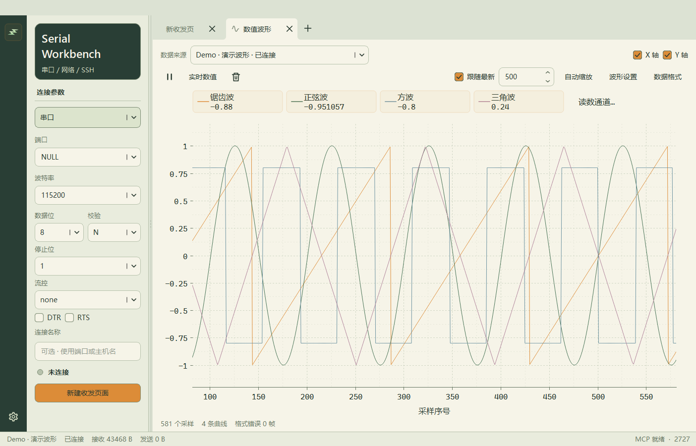
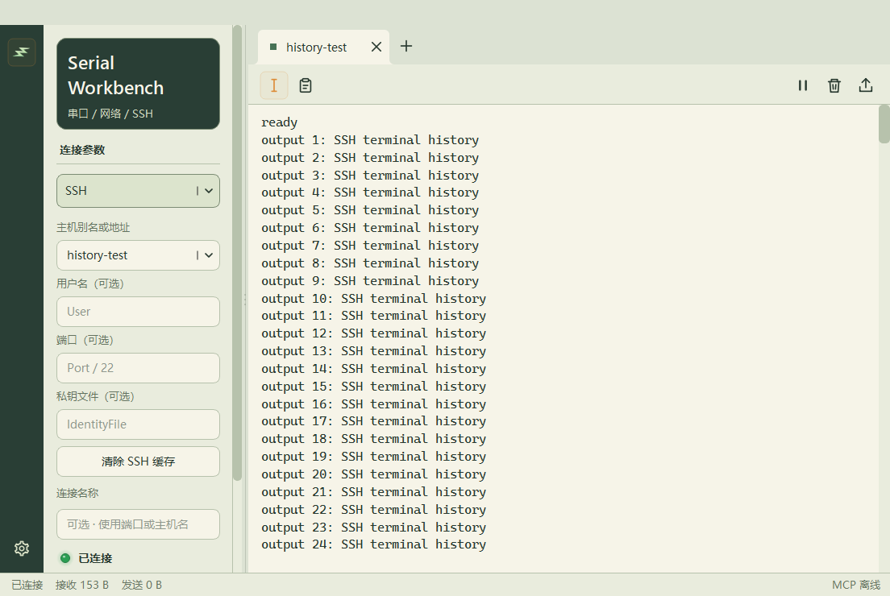
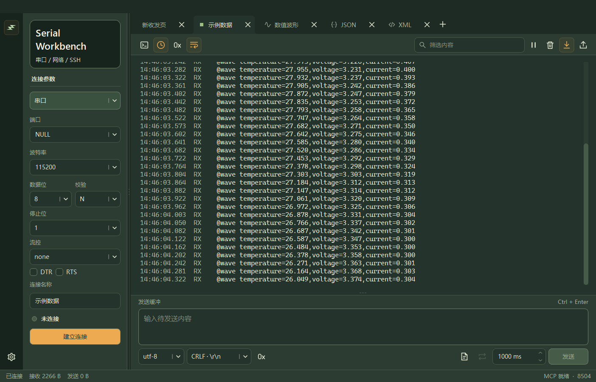
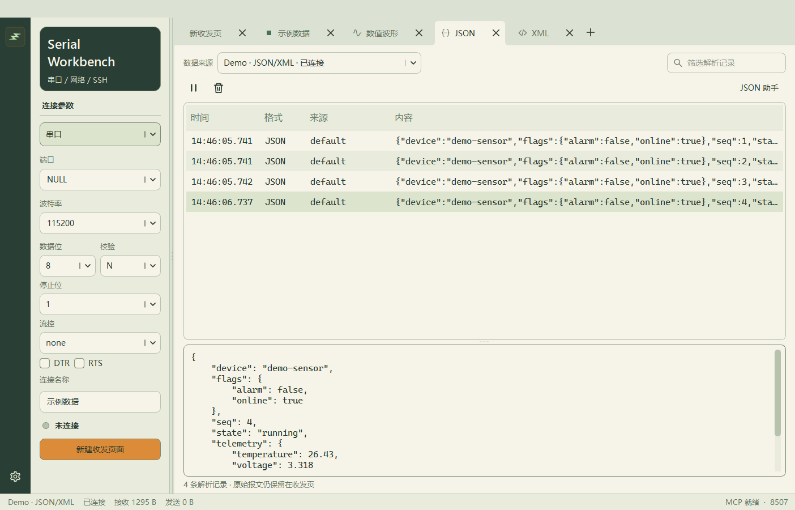
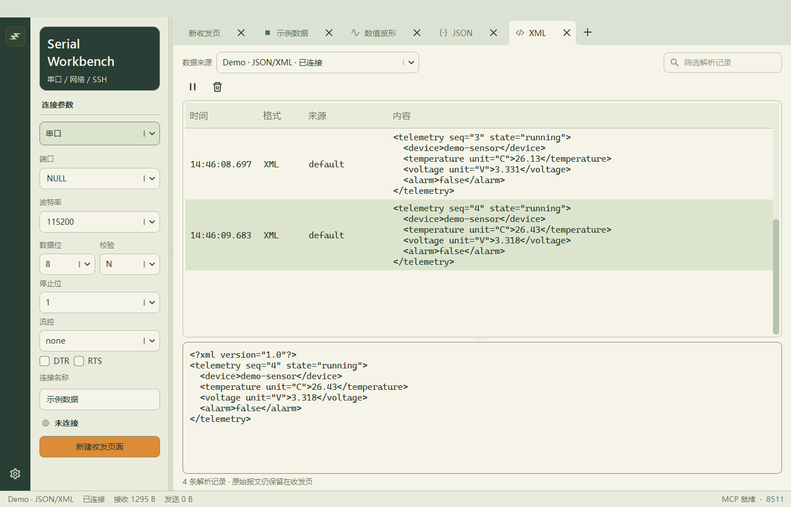
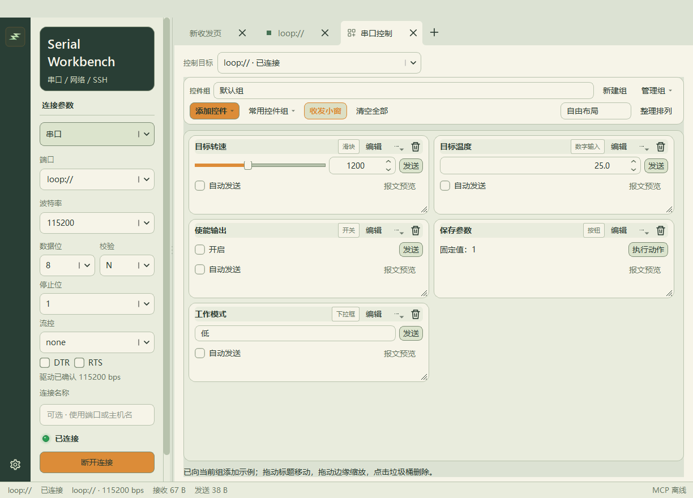
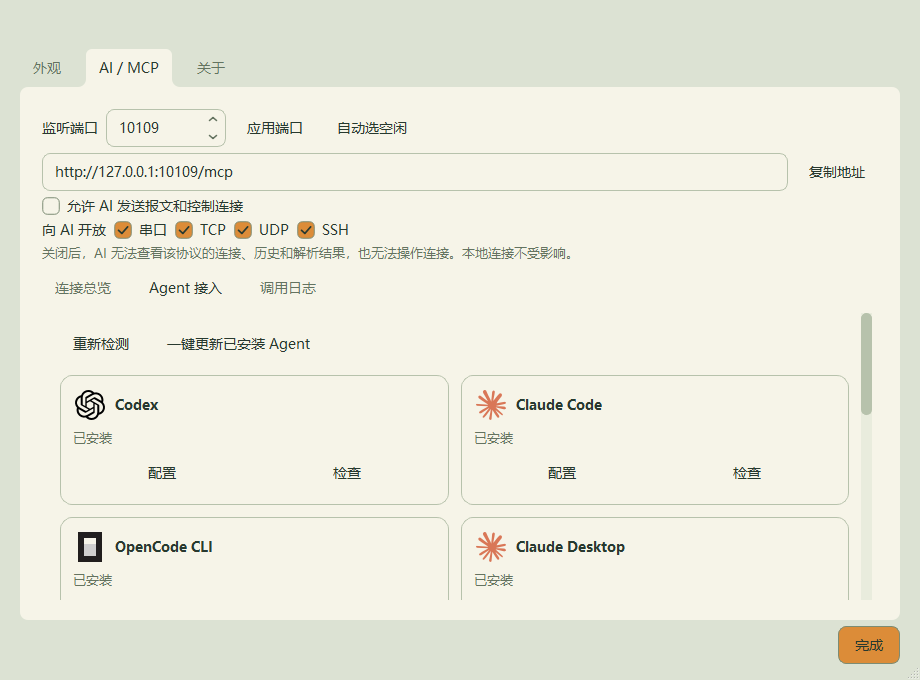

<!-- SPDX-License-Identifier: Apache-2.0 -->
<div align="center">
  
  <h1>Serial Workbench</h1>
  <p><strong>设备、终端与 AI，共享同一个调试会话。</strong></p>
  <p>面向串口、TCP、UDP 和 SSH 的原生桌面调试工作台，集成波形工具与 MCP。</p>
  <p>
    <a href="https://github.com/lilinng-163/serial-workbench/releases/latest"></a>
    
    
    
    <a href="LICENSE"></a>
  </p>
  <p><a href="README.md">English</a> · <strong>简体中文</strong></p>
  <p><a href="https://github.com/lilinng-163/serial-workbench/releases/latest">下载</a> · <a href="#快速开始">快速开始</a> · <a href="#ai--mcp">AI / MCP</a> · <a href="#使用文档">使用文档</a> · <a href="https://github.com/lilinng-163/serial-workbench/issues">问题反馈</a></p>
</div>



## 为什么使用 Serial Workbench？

在一个应用里保持设备连接，查看输出、检查结构化数据、调节参数，同时让 AI 通过 MCP 分析同一份会话。界面和各个 AI 客户端拥有独立读取游标，互不消耗对方的数据。

基于 **Qt 6 / C++17**。Windows 桌面程序与原生 MCP 桥均无需安装 Python 或 Qt SDK。

## ✨ 功能

| | 可以做什么 |
| --- | --- |
| 🔌 **连接调试** | 串口、TCP 客户端/服务端、UDP、SSH；独立标签、实时端口发现与串口断线恢复。 |
| 🖥️ **SSH 终端** | 专用交互终端，保留 **一万行滚动历史**，支持选择复制、ANSI 颜色、输入法和远端 PTY 尺寸同步。 |
| 📈 **数值波形** | 最多 16 路命名曲线，缩放、平移、光标检查；四路定宽实时读数，可自行选择通道。 |
| 🧩 **JSON / XML** | 独立页面共享连接，增量提取与结构化查看，并提供 JSON 助手。 |
| 🕘 **版本回溯** | 在设置中查看最近三个正式版本的特性并下载安装包，窗口底部显示当前运行版本。 |
| 🎛️ **串口控制** | 滑块、数字输入、开关、按钮和下拉框；控件组、自由拖动缩放并跟随窗口宽度、预设与各控件独立自动发送。 |
| 📦 **文件与协议** | 原始字节、XMODEM-CRC 文件传输；带持久状态和校验函数的 C 风格帧脚本。 |
| 🤖 **AI 协作** | Streamable HTTP / STDIO MCP、按协议开放、默认只读，以及独立的 AI 控制权限。 |
| 🎨 **工作空间** | 可分离标签、浅色/深色主题、选色盘与十六进制主题色、自定义背景、数据字体与各页面一键清空。 |

## 📸 界面预览

<table>
  <tr>
    <td width="50%"><br><strong>SSH 终端</strong> · 示例输出与历史回看</td>
    <td width="50%"><br><strong>深色工作台</strong> · 连接与收发日志</td>
  </tr>
  <tr>
    <td><br><strong>JSON 查看</strong> · 结构化演示数据</td>
    <td><br><strong>XML 查看</strong> · 结构化演示数据</td>
  </tr>
  <tr>
    <td><br><strong>串口控制</strong> · 参数卡片与控件组</td>
    <td><br><strong>AI / MCP</strong> · 客户端配置与权限</td>
  </tr>
</table>

以上图片均由实际应用使用生成的演示数据或本地测试会话截取。当前应用界面为中文。

## 📥 下载

**[下载最新版本 →](https://github.com/lilinng-163/serial-workbench/releases/latest)**

v0.15.33 新增主题色选色盘与十六进制输入，自定义色同步浅色/深色界面、分离窗口和串口小窗，并自动保证按钮文字可读。[查看更新说明](docs/releases/0.15.33.md)。

| 文件 | 适合的使用方式 |
| --- | --- |
| `SerialWorkbench-<版本>-windows-x64-setup.exe` | 安装版，提供快捷方式和卸载入口，推荐使用。 |
| `SerialWorkbench-<版本>-windows-x64-portable.zip` | 便携版，完整解压后运行 `SerialWorkbench.exe`。 |
| `SerialWorkbench-<版本>-windows-x64.exe` | 单文件启动器，自动展开并复用本地运行库缓存。 |
| `SHA256SUMS.txt` | 使用 `Get-FileHash -Algorithm SHA256` 核对下载文件。 |

安装包内含运行库与 MCP 桥。SSH 使用 Windows OpenSSH 客户端（`ssh.exe`）。升级前关闭程序及桥接进程；安装版配置保存在 `%LOCALAPPDATA%/SerialWorkbench/settings.json`，便携版保存在程序目录。详见[安装与升级](docs/windows-installer.md)。

## 快速开始

1. 安装或解压后启动 **Serial Workbench**。程序不会自动连接硬件。
2. 选择 **串口 / TCP 客户端 / TCP 服务端 / UDP / SSH**，填写连接参数后建立连接。
3. 串口、网络连接可使用收发日志与发送栏，或切换交互终端。**SSH 直接进入终端**，不提供日志模式切换和串口式发送栏。
4. 点击 **+ → 新建控件页面**，添加波形、JSON、XML 或串口控制页面，再选择数据来源；多个页面可共享一个连接。
5. 打开 **设置 → AI / MCP**，将 AI 客户端接入正在运行的工作台。

收发日志、串口收发小窗和 JSON/XML 记录列表使用统一搜索开关：**Aa** 区分大小写、**ab** 全词匹配、**.*** 正则表达式、**&&** 逻辑匹配，默认全部关闭。开启逻辑匹配后，`温度 && 报警 || 故障` 表示“同时包含温度与报警，或者包含故障”，`&&` 优先于 `||`；搜索内容本身含运算符时加双引号，例如 `"A||B"`。正则与逻辑可组合，正则项内的运算符也可用双引号保护。表达式无效时显示警示边框，悬停可查看原因，记录继续显示。搜索设置随页面或小窗保存；暂停显示时也能重新筛选，筛选不改变 MCP 共享历史。

没有设备时，可在波形数据来源里选择 **Demo · 演示波形**，或通过命令行启动演示：

```powershell
.\SerialWorkbench.exe --demo --view waveform
```


AI 可通过 `list_search_views`、`search_logs` 原生调用 GUI 搜索，通过 `get_frame_script`、`validate_frame_script`、`set_frame_script` 读取、试解析并应用串口脚本。写入需要 AI 控制权限和最新 revision，不覆盖 GUI 未保存内容。安装器默认勾选检测到的 Agent skill，也可在设置 → AI / MCP → Agent 接入 → 配置 skill 中随时安装或更新；启动及切换端口时只读检查各 Agent 的 MCP 地址。详见 [Agent 接入说明](docs/agent-integration.md)。

通过 MCP 修改脚本时，也要把匹配当前协议的 HEX `sample_chunks` 传给 `set_frame_script`，同步更新 GUI 试解析输入；先离线验证，未保存的样本受覆盖保护。脚本编辑器统一使用 skill/指南流程，移除了单独的 AI 提示词窗口。

### 自定义主题色

打开 **设置 → 外观 → 主题色**，通过选色盘选择颜色，或输入 `#RRGGBB` / `#RGB`（例如 `#4080E0`），点击“应用”或离开输入框即可立即保存。无效格式会提示并保留原颜色。浅色/深色背景、按钮、选中状态、标题栏和分离窗口同步配色，按钮文字自动选择清晰的黑色或白色。“恢复默认主题色”回到原有配色；背景图片和数据字体仍可独立设置。

### 终端与工作区快捷操作

| 操作 | 快捷键 / 交互 |
| --- | --- |
| 回看终端历史 | 鼠标滚轮或终端滚动条 |
| 复制 / 中断 | `Ctrl+C` 有选区时复制，无选区时向远端发送中断字符 |
| 复制 / 粘贴 | `Ctrl+Shift+C` / `Ctrl+Shift+V`；右键粘贴可单独开关 |
| 选择 SSH 文字 | `Shift` + 方向键；`Ctrl+Shift` + 左右方向键按词选择 |
| 调整数据字号 | `Ctrl` + 鼠标滚轮 |
| 重命名标签 | 右键菜单，或 `F2` |
| 关闭 / 分离标签 | 中键关闭；拖出标签栏或通过右键菜单分离 |

回看历史时，新输出不会把画面强制拉回底部；开始输入时返回实时屏幕。一键清空只重置本地显示，保留 MCP 共享历史。

### 显示设备波形

每个采样发送一行 **wave/1** 报文：

```text
@wave temperature=25.50,voltage=3.300,rpm=1200
```

```c
printf("@wave temperature=%.2f,voltage=%.3f,rpm=%d\r\n",
       (double)temperature, (double)voltage, rpm);
```

使用命名字段，以 CR、LF 或 CRLF 结束。每帧最多 16 路通道。纯数字、普通日志、JSON 和脚本结果分别处理，不会混入波形。详见[波形专用协议](docs/wave-protocol.md)。

## AI / MCP

先启动工作台，默认地址为 **`http://127.0.0.1:8765/mcp`**；当前实际地址可在 **设置 → AI / MCP** 查看。端口变更后需同步客户端配置。

### 接入 AI 客户端

设置页可配置本机已安装的 Codex、Claude Code、Claude Desktop、OpenCode、Gemini CLI、Pi、Hermes、OpenClaw 和 Grok Build。程序只更新 Serial Workbench 对应条目，保留其他客户端设置。也可手动接入：

<details>
<summary><strong>Codex</strong></summary>

```powershell
codex mcp add serial-workbench --url http://127.0.0.1:8765/mcp
```

或在 `~/.codex/config.toml` 中加入：

```toml
[mcp_servers.serial-workbench]
url = "http://127.0.0.1:8765/mcp"
```

</details>

<details>
<summary><strong>Claude Code</strong></summary>

```powershell
claude mcp add --transport http serial-workbench http://127.0.0.1:8765/mcp
```

</details>

<details>
<summary><strong>OpenCode</strong></summary>

V1 `opencode.json` / `opencode.jsonc` 可合并以下条目：

```json
{
  "mcp": {
    "serial-workbench": {
      "type": "remote",
      "url": "http://127.0.0.1:8765/mcp",
      "enabled": true
    }
  }
}
```

采用 `mcp.servers` 的 V2 配置可使用应用内的版本识别与配置功能，详见 [Agent 接入](docs/agent-integration.md)。

</details>

<details>
<summary><strong>Claude Desktop / STDIO 客户端</strong></summary>

将路径替换为自己的安装目录：

```json
{
  "mcpServers": {
    "serial-workbench": {
      "command": "C:/path/to/SerialWorkbench/SerialWorkbenchMCP.exe",
      "args": ["--url", "http://127.0.0.1:8765/mcp"]
    }
  }
}
```

桥接程序转发到已经启动的桌面工作台。修改配置后，在 AI 客户端重新加载 MCP 连接。

</details>

### AI 可以做什么

| 目标 | MCP 工具 |
| --- | --- |
| 发现会话与端口 | `get_status`、`list_connections`、`list_serial_ports` |
| 读取设备原始输出 | `read_events` 读取指定连接，`read_all_events` 读取混合历史 |
| 查看解析结果 | `read_waveform`、`read_structured`、`read_script_results` |
| 搜索界面显示内容 | `list_search_views`、`search_logs`，与 GUI 共用大小写、全词、正则和逻辑开关 |
| 读取或试解析串口脚本 | `get_frame_script`、`validate_frame_script`，离线试解析不改变正在使用的脚本 |
| 应用串口脚本 | `set_frame_script`，需要 AI 控制权限和最新 revision，保护 GUI 未保存的编辑 |
| 了解使用流程与脚本语法 | `read_usage_guide` |
| 发送数据或管理连接 | `send_data`、`open_connection`、`close_connection`，需要开启 AI 控制权限 |

可以这样向 AI 提问：

> 读取我当前串口最近的 200 条记录，分析启动失败的原因。之后使用 next_cursor 继续，不要重复分析旧输出。

> 检查 temperature 和 voltage 通道的突变，并与原始接收记录关联。

附带的 [Serial Workbench skill](skills/serial-workbench/SKILL.md) 说明连接选择、增量读取、原生搜索与 C 风格帧脚本。AI 可直接调用 `read_usage_guide` 获取正文，也可在安装器中选装对应 Agent 的 skill。AI 打开的连接和应用的脚本会同步显示在界面中；活动提示可直接打开调用详情与调用日志。

### 权限与共享历史

- 新配置默认只允许 AI 读取；发送、建立和关闭连接需要开启 **允许 AI 发送报文和控制连接**。
- 串口、TCP、UDP、SSH 分别设置开放范围。关闭某协议后，MCP 隐藏对应连接与历史，本地操作继续工作。
- 服务仅监听本机回环地址，不启用鉴权；本机可访问该端口的程序能够读取权限允许的数据。
- 共享历史最多保留 20000 条记录或 8 MiB。每个读者保存自己的游标，继续读取时检查 `gap` 与 `session_id`。终端滚动历史是独立的显示缓冲区。
- WSL、容器、远程 Agent 的 `127.0.0.1` 指向各自环境，需要使用能访问 Windows 主机的客户端配置。

## 使用文档

| 文档 | 内容 |
| --- | --- |
| [Agent 接入](docs/agent-integration.md) | 客户端格式、配置路径与连接检查 |
| [波形专用协议](docs/wave-protocol.md) | 分帧、通道名、数值类型与限制 |
| [版本回溯](docs/version-history.md) | 最近正式版本的特性与安装包 |
| [串口控制](docs/serial-controls.md) | 控件组、预设、模板和自动发送 |
| [帧脚本](docs/frame-scripts.md) | C 风格解析 API、校验与示例 |
| [JSON 助手](docs/json-assistant.md) | JSON 结构化工具 |
| [串口文件传输](docs/serial-file-transfer.md) | 原始字节与 XMODEM-CRC |
| [实时端口发现](docs/live-ports.md) | 端口检测与 USB 设备信息 |
| [Windows 安装](docs/windows-installer.md) | 安装、升级、卸载与分发验证 |
| [项目结构](docs/project-structure.md) | 源码组织 |
| [Docker 开发](docker/README.md) | Linux 构建环境 |

## 从源码构建

Windows 构建需要 **Qt 6.9+**（Widgets、Network、SerialPort、Core5Compat、Svg、Test）、**CMake 3.21+**、Ninja 和匹配的 C++17 编译器。当前发行包使用 Qt 6.11.1 与 MinGW 13.1。

```powershell
git clone https://github.com/lilinng-163/serial-workbench.git
cd serial-workbench

$env:QTDIR = 'C:/Qt/6.11.1/mingw_64'
$env:MINGW_BIN = 'C:/Qt/Tools/mingw1310_64/bin'
.\scripts\build.ps1
```

构建脚本会编译应用、运行原生测试，并将 Qt 运行库部署到 `dist/SerialWorkbenchNative`。Python 仅用于可选的集成测试：

```powershell
python -m venv .venv
.\.venv\Scripts\python.exe -m pip install -r tests/integration/requirements.txt
.\.venv\Scripts\python.exe tests/integration/smoke_native.py --expected-version 0.15.33
```

安装 NSIS，并提供匹配的 Qt 源码目录收集许可证，即可生成安装包、单文件启动器和便携 ZIP：

```powershell
.\scripts\package-release.ps1 -QtSourceRoot 'C:/Qt/6.11.1/Src' -MakeNSIS makensis
```

分发文件与 SHA-256 校验文件位于 `dist/releases/`。开发测试工具、个人配置和自定义背景图片不会进入发行包。

## 参与贡献

欢迎提交问题和聚焦具体功能的 Pull Request。反馈问题时，请附应用版本、Windows 版本、连接类型、复现步骤，以及截图或示例报文；提交前移除凭据和私人设备数据。代码改动请运行相关原生测试。

## 许可证

[Apache-2.0](LICENSE)。随附库、字体和 Agent 图标保留各自许可证与署名，分发包中的 `licenses/` 和对应源码目录均可查看。
