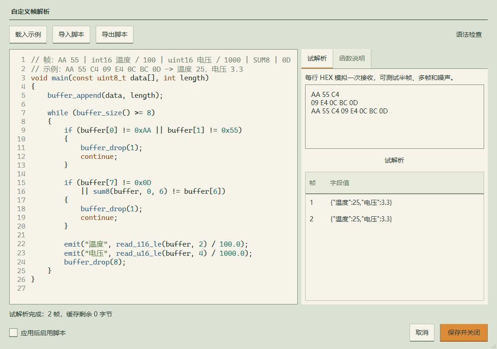
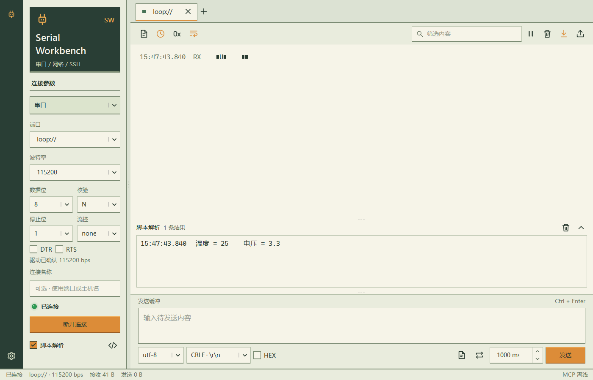

# 自定义帧脚本

脚本用于从串口字节流中提取自定义协议的数值。每个串口会话独立保存代码与启用状态、缓存和 `static` 变量。TCP、UDP、SSH 和演示会话不显示脚本入口，也不能启用脚本；旧版保存的非串口脚本配置会被忽略。

## 开始使用

1. 选择串口收发页面，在左侧「脚本解析」旁点击代码图标。
2. 修改内置示例，或导入 `.c` / `.txt` 脚本。AI 通过 MCP 的使用指南和 skill 了解脚本语法；修改代码时也要更新右侧「试解析」里的 HEX 样本，使其符合当前协议。
3. 点击「语法检查」，在右侧输入 HEX 后点击「试解析」。每行表示一次接收，用换行模拟半帧与分块。
4. 勾选「应用后启用脚本」，保存。也可保存草稿，随后在左侧启用。
5. 返回收发页，在原始收发区下方的「脚本解析」分区查看字段结果。拖动上方分隔线调整高度，右上角箭头收起或展开；选中记录可用 Ctrl+C 或右键复制 JSON。

试解析使用独立缓存，不发送硬件数据，也不改变正在运行的连接脚本。试解析每次重新开始；支持 1～64 行 HEX，总计最多 64 KiB。





## 固定入口与分帧

```c
void main(const uint8_t data[], int length)
{
    buffer_append(data, length);

    // 示例：每两个字节组成一个小端 uint16。
    while (buffer_size() >= 2)
    {
        emit("value", read_u16_le(buffer, 0));
        buffer_drop(2);
    }
}
```

`data` 是本次接收的原始字节，`length` 是字节数。一次接收可能含半帧、一帧或多帧，不能直接当成设备协议的完整帧。`data[i]`、`buffer[i]` 按从零开始的下标读取 0～255，数组不可写。

`buffer` 跨调用保留。先追加字节，再检查帧头、长度和校验；不足一帧时退出，等待下次数据。找到完整帧后输出字段并消费相应字节；噪声或无效帧可消费一个字节继续寻找帧头。每轮循环都应消费数据或改变退出条件。

[完整示例](../examples/frame-parser.c) 使用 8 字节帧：`AA 55` 帧头、2 字节小端有符号温度、2 字节小端无符号电压、前 6 字节的 SUM8、`0D` 帧尾。HEX `AA 55 C4 09 E4 0C BC 0D` 输出温度 25、电压 3.3。

## 内置函数

所有数组参数均为 `data` 或 `buffer`。偏移、长度必须为非负整数，读取和消费都检查边界。

| 函数 | 含义 |
| --- | --- |
| `buffer_append(array, count)` | 将数组的前 count 字节追加到缓存；省略 count 时追加整个数组 |
| `buffer_size()` | 当前缓存字节数 |
| `buffer_drop(count)` | 提交当前输出字段，并从缓存头部消费 count 字节 |
| `buffer_clear()` | 清空缓存，不提交当前字段 |
| `emit("名称", value)` | 设置当前帧的一个数值字段，同名字段覆盖 |
| `emit_frame()` | 提交当前帧字段；main 返回时也提交尚未提交的字段 |
| `read_u8(array, offset)` / `read_i8(array, offset)` | 读取无符号 / 有符号 8 位整数 |
| `read_u16_le` / `read_u16_be` | 读取 16 位无符号整数，参数为 `(array, offset)` |
| `read_i16_le` / `read_i16_be` | 读取 16 位有符号整数 |
| `read_u32_le` / `read_u32_be` | 读取 32 位无符号整数 |
| `read_i32_le` / `read_i32_be` | 读取 32 位有符号整数 |
| `read_f32_le` / `read_f32_be` | 读取 IEEE 754 单精度浮点数，拒绝 NaN 和无穷值 |
| `sum8(array, start, count)` | 指定范围字节之和的低 8 位 |
| `xor8(array, start, count)` | 指定范围字节异或 |
| `crc16_modbus(array, start, count)` | CRC16 / Modbus，初值 0xFFFF，反射多项式 0xA001；返回数值，比较报文字段时自行选择大小端 |
| `min(a, b)` / `max(a, b)` / `abs(a)` | 数值运算 |

只有至少一个字段时才产生输出帧。单次 main 可以输出多帧。`emit` 的输出为有限数值，字段名长度为 1～64 个字符。

## C 风格语法

支持块作用域、单个数值变量声明、`const`、`static`、赋值与复合赋值、自增自减、`if / else`、`for`、`while`、`break`、`continue`、`return;`、三元运算和类型转换。注释支持 `//` 与 `/* ... */`。

可用类型：`int`、`short`、`long`、`char`、`byte`、`bool`、`float`、`double`、`size_t`、`uint8_t` / `int8_t` / `uint16_t` / `int16_t` / `uint32_t` / `int32_t`，以及 `signed` / `unsigned` 的 char、short、int、long 形式。char 为有符号 8 位，byte 为无符号 8 位，int / long 为有符号 32 位，size_t 为无符号 32 位。赋值与转换按目标整数位宽截断；float 按单精度舍入。

两个整数做除法时向零截断。需保留小数时使用 `100.0` 或 `(double)value`。位运算统一使用无符号 32 位，右移补零，位移范围 0～31；与完整 C 的整数提升和溢出语义不完全一致。内部数值计算使用 double，整数字面量及整数中间运算最多精确到 `2^53 - 1`，超过范围会报错。支持十进制、十六进制及科学计数法。

这是应用内解释执行的语法子集，仅支持固定 main 和上述内置函数。没有头文件、宏、结构体、自定义数组、用户函数、可写指针或动态内存，也没有文件、网络、系统命令或发送报文的接口。语法检查验证语法和内置函数参数数量；变量作用域、数值与数组边界在执行时检查。

## 状态、输出与执行限制

脚本只接收启用后新到达的数据，不追溯历史。重新应用代码、关闭再启用或连接重建会清空缓存及静态变量；已有采样和解析记录继续保留。连接或脚本更改后尚未返回的旧处理结果会被丢弃。

| 限制 | 上限 |
| --- | --- |
| 脚本 UTF-8 源码 | 64 KiB |
| 串口接收缓存 | 64 KiB |
| 单次 main 执行 | 200,000 步或约 100 ms，以先到者为准 |
| 单次输出 | 1,024 帧，每帧 16 个字段 |
| 后台待处理队列 | 128 批或 256 KiB |

解释器在独立线程按接收顺序执行。越界、除零、超限等错误会停用脚本并在左侧显示原因；原始收发和连接继续工作。修正脚本后重新启用即可。

脚本、波形文本和 JSON / XML 分别解析同一份原始数据，使用独立的历史与游标。启用脚本不会关闭波形文本解析。原始报文、HEX 和日志导出始终保留接收字节，脚本不会消耗 GUI 或 AI 的日志游标。

脚本结果只写入独立的脚本记录，在收发页展示。每个来源最多保留 500 条或 2 MiB；界面显示最近 200 条。分区高度和收起状态按连接保存；收发工具栏的暂停显示同时暂停脚本结果的显示，后台继续解析。分区清空按钮仅清空脚本显示，收发工具栏清空按钮清空两个显示区，都保留共享历史与 MCP 游标。

波形和实时数值仅接收 [wave/1 专用协议](wave-protocol.md)：例如 `@wave temperature=25.5,voltage=3.3`，以 CR、LF 或 CRLF 结束。无前缀数字、CSV、JSON 和脚本的 emit 字段不会自动进入波形。JSON / XML 控件只提取对应格式，不列出脚本记录。同一串口的自定义帧、波形文本和日志可以交替发送；文本行与二进制帧之间需有清楚的行边界。例如内置帧以 CR 结束，紧随其后的完整波形文本行仍可正常解析。

AI 通过 MCP 工具主动读取解析结果，不会自动逐帧推送；读取不需要开启 AI 写权限。先使用 `list_connections` 选择 `kind: "serial"` 且 `script_enabled: true` 的连接，然后调用：

```json
{
  "name": "read_script_results",
  "arguments": {
    "channel_id": "<连接ID>",
    "cursors": {"default": 0},
    "limit": 100
  }
}
```

输出在 `sources.default.records` 中，例如 `{"format":"script","value":{"温度":25,"电压":3.3}, ...}`，`event_seq` 对应完成该帧的原始接收批次。下次把 `sources.default.next_cursor` 作为该 AI 自己的游标；其他 AI 和界面分别保留自己的游标。`read_waveform` 只返回设备按波形格式发送的数据，`read_structured` 只返回 JSON / XML；三类结果的游标分别保存。脚本可由界面编辑启用，或由具有控制权限的 MCP 使用 revision 同步应用；结果使用独立游标读取。

0.14.0 起脚本结果使用 `read_script_results`，不再由 `read_waveform` 或 `read_structured` 返回。更新后应刷新 AI 客户端的 MCP 工具列表。

AI 接入 MCP 后可用 `read_usage_guide(topic="frame_script")` 直接获取同一份脚本规则与可运行示例；`read_usage_guide()` 返回软件 skill 正文和服务端路径。没有本机文件访问权限的 Agent 可直接读取正文。AI 可调用 get_frame_script 读取代码和 revision，使用 validate_frame_script 离线试解析，再在用户授权且控制权限开启时，以 expected_revision 调用 set_frame_script 保存并明确启用/停用。GUI 未保存编辑或正在试解析时不会被覆盖。

set_frame_script 的可选 sample_chunks 参数同步保存 GUI 试解析输入（最多 64 块、合计 64 KiB）；get_frame_script 返回保存的输入，revision 也随输入变化。GUI 未保存的 HEX 修改和正在试解析时均拒绝覆盖。省略 sample_chunks 保留原输入，空数组清空。修改代码时请提供新协议的样本，并先做离线试解析。
