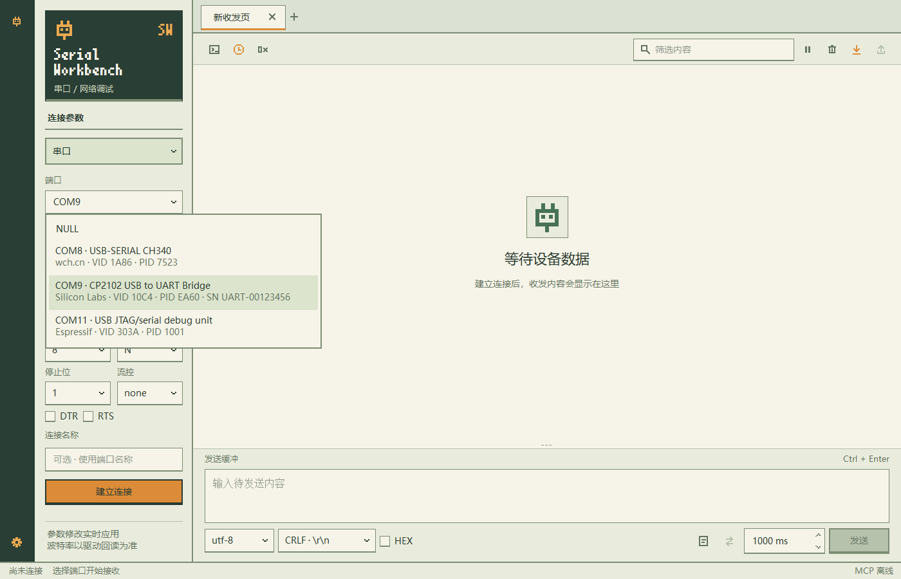

# 实时端口发现（0.10.4）

端口标签显示「实时扫描」，不再提供手动刷新按钮。Windows 设备变化会触发扫描，并每 500 ms 补查一次。扫描仅枚举设备，不打开端口。

列表仅增删发生变化的行；下拉菜单展开时仍更新，不清空重建整个列表。端口说明与 USB Serial/JTAG 提示同步更新。

尚未连接的草稿中，选中的 COM 端口消失后，输入字段回到 NULL，草稿同步更新。已建立的串口连接断开后保留原 COM 名称，按钮显示「停止重连」，状态显示「等待设备恢复」；切换标签和独立窗口后仍保留。下拉列表只列出当前在线设备，保留的 COM 名称不冒充在线端口。插入新设备会加入列表，不会自动建立新连接或擅自选择它。

端口字段只读，可从下拉列表选择，不能输入或删除 NULL / COM 名称。软件扫描与连接状态仍可更新显示。开发用的 loop:// 通过 MCP 的 open_connection 使用，不在端口选择器中提供。

设备移除会主动通知已打开的串口连接，即使没有接收数据、驱动尚未报读写错误，也会进入「等待设备恢复」。保留原设备身份、参数和历史记录；同一次断开只输出一条提示，后台失败重试不再刷屏。原端口恢复后继续接收，再次断开会产生新的单次提示。手动停止会终止重试；扫描不消耗接收数据。

验证覆盖：

- 设备新增、移除及描述变更；未变化时不重置模型。
- 展开的下拉列表持续更新；草稿中的失效端口变为 NULL，恢复中的连接保留原 COM。
- NULL 和 COM 名称不可通过键盘或输入法修改；下拉选择正常，旧草稿端口清除。
- 标签切换保留正在恢复的 COM；无读写错误时主动进入设备恢复状态，原连接仍可手动停止。
- 连续失败重试不新增日志；恢复后再次断开新增一次提示；手动停止后不再重试，历史记录不受影响。
- 图标悬停及键盘焦点只改变图标颜色，鼠标反馈仅轻微位移和缩放；移除边框与背景高亮，避免标签关闭按钮外溢。
- Release 编译，离屏与 Windows 桌面各 17 项测试通过；插拔状态由可控设备快照模拟，不打开真实硬件。
- 打包版 HTTP / STDIO 验证通过；真实 Windows 启动时，已不存在的 COM8 设置清除为 NULL。

