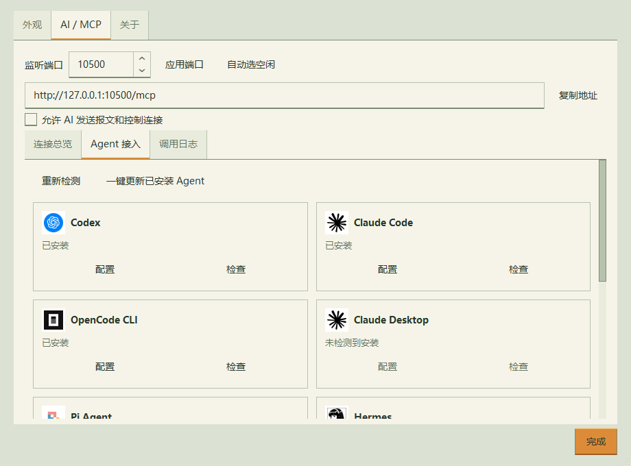

# 本地验证 0.15.6

2026-10-14，Windows 11，Qt 6.11.1 / MinGW 13.1，Release 构建。

- NativeTests：84 通过；ScriptTests：44 通过；AgentTests：18 通过，均无失败。
- Agent 配置测试使用隔离的临时安装路径和配置目录，覆盖九个客户端以及 OpenCode V1/V2。
- 校验其他服务与注释保留、备份完整、连续端口更新、无效配置不被覆写、未安装客户端不可配置。
- 实际 HTTP 初始化握手验证批量更新；没有启动各 Agent 的 AI 对话。
- 已监听端口切换失败后原服务仍运行；自动空闲端口切换保留会话及已有采样。
- 已保存端口被其他 socket 占用时，默认启动自动改用空闲端口、立即保存；下一次启动复用此端口，真实 HTTP 握手通过。
- X/Y 轴独立隐藏、绘图区扩大、坐标范围保持和设置恢复通过。
- Windows 原生截图检查端口文本、两列布局和图标；设置大小恢复与滚动测试通过。
- 单文件/便携包测试：清洁分发内容、SHA256 清单、移除 SDK 环境后运行、HTTP/STDIO 独立读取与权限、整数/浮点波形、中文路径、首次启动、缓存复用、缓存损坏修复通过。

运行 `scripts/build.ps1` 执行三组 QtTest；`tests/integration/smoke_release.py --release-dir dist/local/0.15.6 --expected-version 0.15.6` 执行打包检查。单文件交付后清理临时构建和测试用 ZIP，重新执行打包检查前需生成便携 ZIP。

设置页截图：
