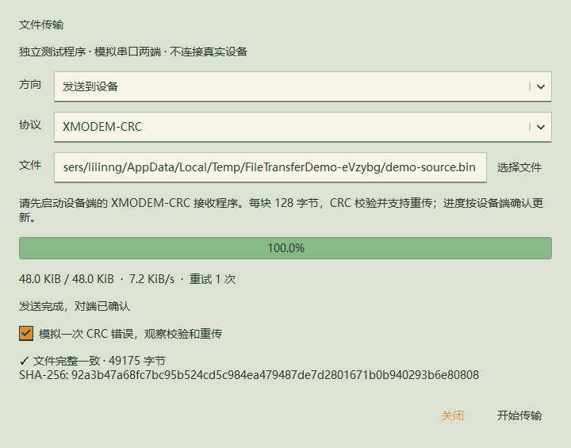
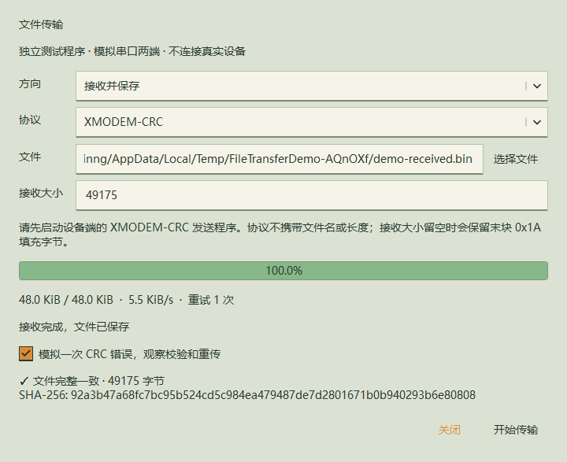

<!-- SPDX-License-Identifier: Apache-2.0 -->
# 本地验证 0.15.8

Qt 6.11.1 / MinGW 13.1，Windows x64，Release 构建。仅本地构建和验证，未推送或发布 Release。

- QtTest：84 个界面/核心测试、44 个脚本测试、18 个 Agent 测试、29 个传输与中键关闭测试，共 175 项通过。
- 传输覆盖：空文件、1/127/128/129/4096/33001 字节、序号循环、任意接收分块、CRC 错误重传、ACK 丢失及重复块去重、结束 ACK 丢失、接收 1024 字节块、取消、超时、写失败、提前结束、未知长度填充及原文件保护。
- 界面覆盖：进度按 ACK 更新，未知长度的原始接收，完成/取消状态，主窗口和独立窗口中键关闭、不同标签间按下/释放不误关、关闭连接标签实际移除连接。
- 虚拟串口 Demo：原始字节发送/接收、XMODEM-CRC 发送/接收四种组合，均成功传输 49175 字节。XMODEM 注入一次 CRC 错误后自动重传。内容逐字节相等，源/目标 SHA-256 同为 `92a3b47a68fc7bc95b524cd5c984ea479487de7d2801671b0b940293b6e80808`。
- 单独部署的 Demo 在 PATH 不含 Qt SDK / MinGW 的环境成功运行并生成校验报告。
- 安装器：以独立 Installer Test 注册项在工作区中文自定义路径安装旧版本注册信息，再不传入 `/D` 安装 0.15.8，自动找到原路径，更新版本标记，保留设置及自行放入的文件。
- 安装版在无 SDK 环境启动；验证运行中覆盖保护、HTTP/STDIO 的 10 个 MCP 工具、独立历史读取及写权限。卸载移除自有文件、注册项及快捷方式，保留个人设置和用户文件。
- 正式安装文件清单中没有 `FileTransferDemo.exe`。演示程序位于 `dist/test-demo/0.15.8/`，安装器位于 `dist/local/0.15.8/`。
- 程序、安装器、卸载器的九种透明闪电图标资源均通过检查。旧端口绘制入口也统一渲染闪电，覆盖终端空白页、侧栏和新建页面菜单。

测试使用虚拟传输和串口 loopback，未对真实设备端的 XMODEM 实现或物理 COM 口做硬件传输验证。

