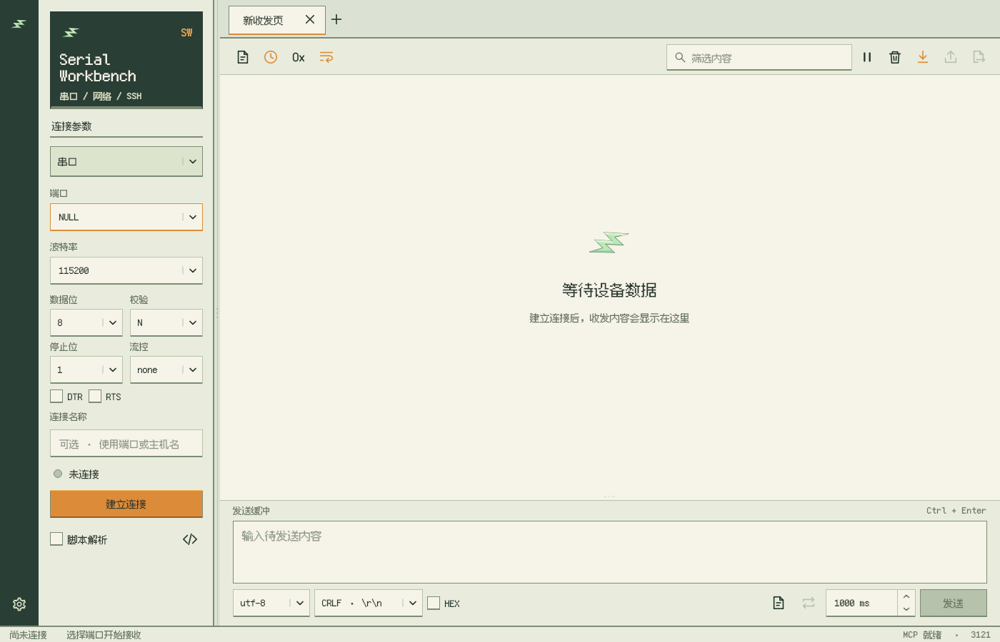

<!-- SPDX-License-Identifier: Apache-2.0 -->
# 0.15.9 验证

空白收发页取消闪电图标外的背景和边框，绘制区域从 48 × 48 调整为 72 × 72 像素，继续居中显示。

Qt 6.11.1 / MinGW 13.1 Release 构建成功，175 项 QtTest 通过。实际窗口截图确认图标透明、无方框且尺寸增加。安装包包含完整运行库及原生 MCP 桥，独立传输 Demo 不在安装清单内。

独立 Installer Test 注册项验证了安装到中文自定义路径、不传 `/D` 的跨版本升级、设置和用户文件保留、无 SDK 启动、运行中覆盖保护、HTTP/STDIO MCP 及卸载清理。安装器和主程序的九种透明图标资源检查通过。

