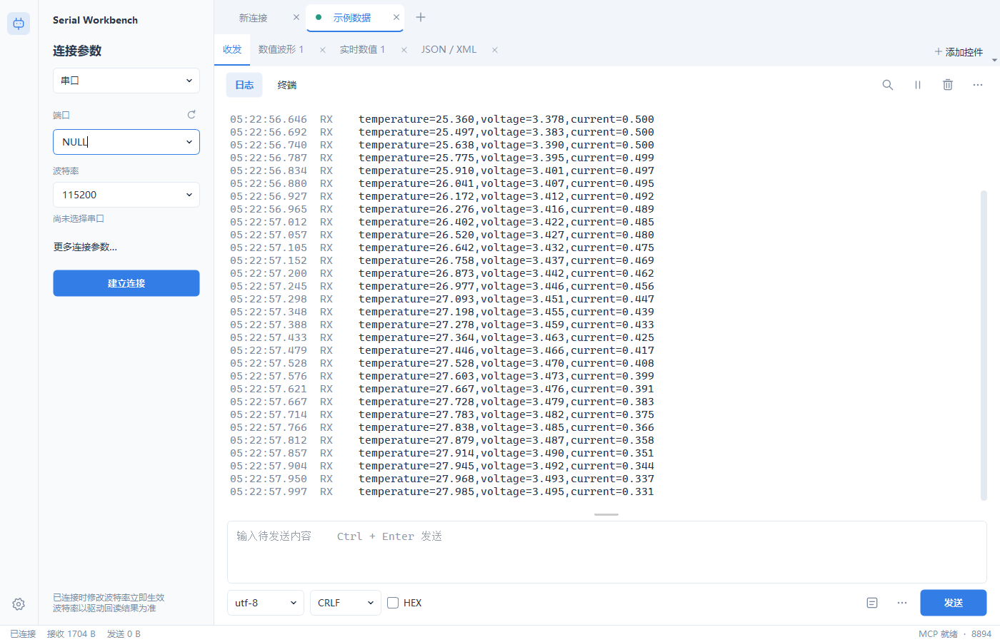
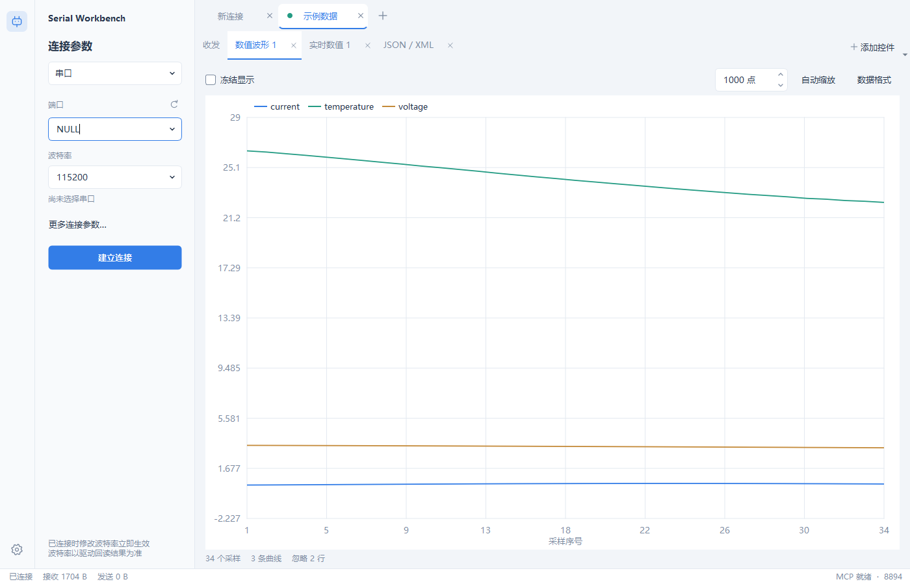
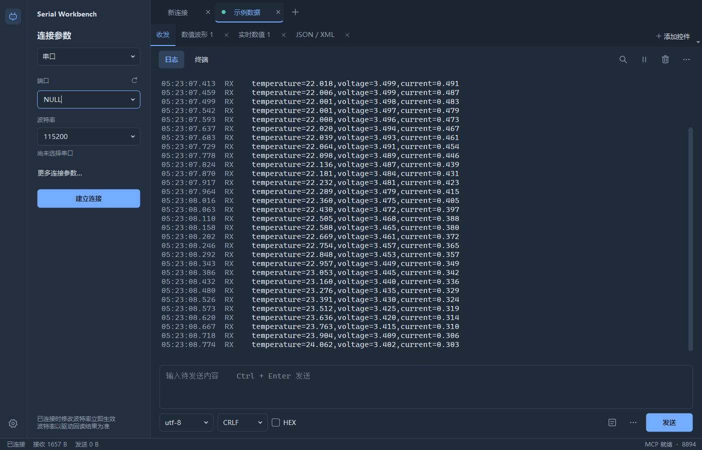

# 原生版 0.7.0 验证记录

验证日期：2026-10-12。Windows 11 x64，Qt 6.11.1，MinGW 13.1，C++17 Release。

## 构建与回退

原生源码位于 `native/`，构建入口为根目录 `build-native.ps1`。GUI 与 STDIO 桥都编译为独立 Windows 可执行文件，运行不需要 Python。部署目录为 `dist/SerialWorkbenchNative/`，默认启动入口为 `start.bat`。

Git 分支：`feat/qt-native-workbench`。旧 Python 0.6.0 源码保留，基线提交 `7e74c8c`；旧打包目录 `dist/SerialWorkbench/` 保留。

## 功能检查

- Release 构建及 Qt 运行库部署成功。
- QtTest：8 个功能用例通过（含初始化和清理报告为 10 项），在 offscreen 和 Windows 平台验证。
- 覆盖 ANSI 颜色重置、终端清屏及光标、UTF-8 / GBK 分片、独立游标、串口回环重配置、实际 TCP / UDP socket、标签位置与排序、端口文字空间、收发比例、悬停动画、设置恢复和权限。
- 官方 MCP Python SDK 验证打包后的 HTTP 与原生 STDIO 桥：9 个工具、同一会话、独立读取、写权限关闭/开启、等待数据期间其他客户端可发送、回环收发、波形、连接复用、非法 HEX 与游标处理。
- 使用正常 Windows 用户桌面生成收发、波形、数值、设置和深色界面截图。

串口参数通过 Qt setter 检查返回值，并在 Windows 调用 `GetCommState` 回读波特率。检查失败时会断开并报错，避免继续显示已经成功应用。软件回环测试仅验证参数流转与界面状态，不证明实体 UART 线速；本次未打开实际 COM 硬件。

只读枚举发现当前 COM9 为 `USB\\VID_303A&PID_1001&MI_00`，使用 `usbser` 驱动。该标识对应 Espressif USB Serial/JTAG；界面增加其 USB 速率提示。[Espressif 官方说明](https://docs.espressif.com/projects/esp-brookesia/en/latest/system/usb_cli.html) 指出此通道没有物理 UART 波特率，因此 1200 与 115200 下均能读到文本不能证明应用未配置驱动。

## 启动测量

测试脚本：`tests/benchmark_startup.py`。相同 Windows 用户桌面，每版启动 3 次，使用独立临时设置和 MCP 端口。测量从启动进程到第一次发现该进程的可见、有标题窗口，正常关闭测试窗口。

| 版本 | 第 1 次 | 第 2 次 | 第 3 次 | 中位数 |
| --- | ---: | ---: | ---: | ---: |
| Python 0.6.0 打包版 | 1567.8 ms | 1130.8 ms | 1153.6 ms | 1153.6 ms |
| Qt C++ 0.7.0 打包版 | 217.4 ms | 305.7 ms | 298.8 ms | 298.8 ms |

这是本机普通文件缓存下的窗口启动测量，未控制冷缓存，也不代表设备连接耗时或持续收发吞吐。

## 界面

