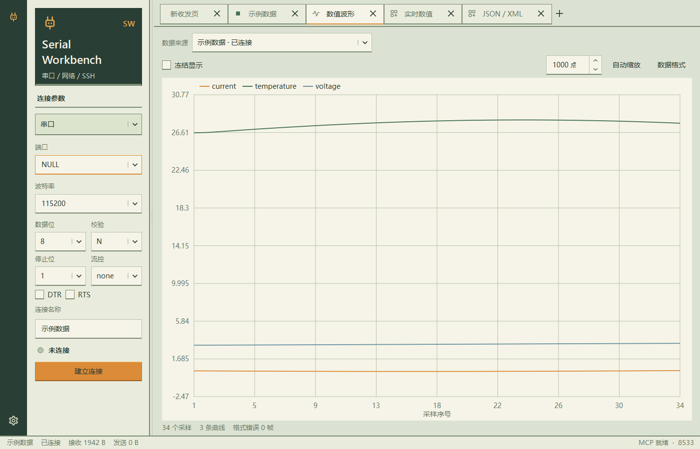

<!-- SPDX-License-Identifier: Apache-2.0 -->

# 波形专用协议 wave/1

从原生版 0.15.0 起，数值波形和实时数值使用带 `@wave ` 前缀的专用文本行；当前开发版另支持 `@wave[流名] `，兼容未命名报文。普通日志、裸数字、CSV、JSON 和脚本结果不自动成为波形采样；原始收发、脚本解析及 JSON/XML 提取继续独立工作。



## 一帧的格式

```text
@wave count=120,temperature=25.50,voltage=3.300\r\n
```

这里的 `\r\n` 表示实际回车与换行字节，不是四个可见字符。每帧独占一行，首字节必须是 `@`，前缀大小写固定为 `@wave`，后面跟一个 ASCII 空格；帧结束可使用 CR、LF 或 CRLF。不得在同一行前面加日志时间、标签、空格或二进制字节。

- 每帧由 1～16 个 `名称=数值` 字段组成，用英文逗号分隔。
- 名称就是通道标识，区分大小写，调整字段顺序不会改变归属；请持续使用固定名称。
- 名称用字母、汉字、数字和下划线组成，不能以数字开头，最多 64 个字符。同一帧内名称不能重复。
- 支持整数、负数、小数、科学计数法及其混合，例如 `123`、`-12`、`3.3`、`.125`、`1.25e-3`。
- 名称、等号和数值两侧可以有空格或 Tab；名称内部和数值内部不能有空格。
- 数值必须有限，不接受 `NaN`、`inf`、十六进制或附加单位。单位可以写在通道名中，例如 `voltage_mV=3300`。

例如以下两帧会更新同样两个通道：

```text
@wave temperature=25.5,voltage=3.3
@wave voltage=3.4,temperature=25.6
```

每行是一份采样，建议一起发送本次需要展示的全部通道。缺失字段不补零；实时数值显示每条流最近一帧包含的字段，范围沿用当前波形窗口与清空边界。串口、TCP 和 UDP 共用此协议，各连接及网络发送方独立拼接和保存数据。

## 多组数据与多个串口

```text
@wave[imu] roll=10,pitch=20,yaw=30
@wave[motor] rpm=1200,current=0.8
```

`[流名]` 紧跟 `@wave`，`]` 后必须有 ASCII 空格。流名区分大小写，支持字母、汉字、数字、下划线和连字符，以字母或下划线开头，最多 32 个字符；每个连接对端最多记录 32 个不同流名（包括空名）。不允许空括号 `@wave[]`；原格式 `@wave ...` 代表未命名流。

不同串口各自独立，无需使用全局唯一流名。同一串口的 `imu`、`motor` 也分别识别，曲线和实时数值使用 `[imu]/yaw`、`[motor]/yaw` 这样的名称，同名字段不会连接为同一条曲线。3D 模型页可明确选择流名。流名来自设备报文；软件无法推断两个同名、同格式但不同含义的未命名报文。

MCU 示例：`printf("@wave[imu] roll=%.2f,pitch=%.2f,yaw=%.2f\r\n", roll, pitch, yaw);`。必须保证各帧完整发送；多个任务并发写同一个 UART 时，应在设备端串行化整帧写入，流名不能修复已经交错的字节。

## C / C++ 发送

```c
int count = 120;
float temperature = 25.5f;
double voltage = 3.300;

printf("@wave count=%d,temperature=%.2f,voltage=%.3f\r\n",
       count, (double)temperature, voltage);
fflush(stdout);
```

`float` 传入 `printf` 时提升为 `double`，可与整数在一帧内混合打印。需要保留双精度数值的更多有效位时可使用 `%.17g`。接收端统一按双精度数值存储；整数在 `±(2^53 - 1)` 范围内可精确表示。实时数值采用可还原数值的最短文本显示，不将大整数截成九位有效数字。

## 无效帧与分包

前缀可以跨接收批次，半帧会等待行结束，多帧也可以一次到达。一帧最多 8192 字节；超长帧丢弃到下一个行结束符后恢复。每个来源的所有流共用最近 5000 个采样的上限与连续序号，波形界面最多显示 16 条曲线。流名错误或新增流超过上限时整帧拒绝，已有流仍能继续接收。

没有正确前缀的行直接跳过，不尝试 JSON 或通用数字解析，也不计入波形格式错误。带前缀的行若存在重复名称、无效数值、空字段、尾逗号或超过通道数限制，则整帧丢弃并计一次格式错误，不产生部分通道采样。原始收发日志仍完整保留这些字节。

## MCP

`read_waveform` 必须指定 `channel_id`，返回 `protocol: "wave/1"`。`sources` 内各来源的 `samples[].values` 以通道名为键；命名采样另有 `stream` 字段，未命名采样保留原结构。`available_streams` 列出已发现的流名，空字符串表示未命名；历史已淘汰的流名仍可能在列表中。`rejected_lines` 只统计无效专用帧，不统计普通日志。

`read_waveform(channel_id=目标ID, stream="imu", limit=100)` 先筛选流名，再返回每个对端最多 100 条保留样本；`stream=""` 只取未命名，省略参数则返回所有流。`index` 和 `total_samples` 始终为该对端所有流的序号/累计数量，筛选后的序号可能不连续。读取不消费共享历史。旧客户端如不识别 `samples[].stream`，应只读 `stream=""`，避免合并不同流的同名字段。

`read_script_results` 读取串口自定义帧脚本结果，`read_structured` 读取 JSON/XML，`read_events` 读取完整原始收发历史。三类解析结果互不混入。

## 从 0.14.x 迁移

旧版的 `temperature=25.5,voltage=3.3` 需改为 `@wave temperature=25.5,voltage=3.3`。原 CSV 需增加通道名称，例如 `@wave CH1=1.2,CH2=3.4`；原数值 JSON 继续由 JSON/XML 控件处理，需要绘图时另发一行专用波形帧。
