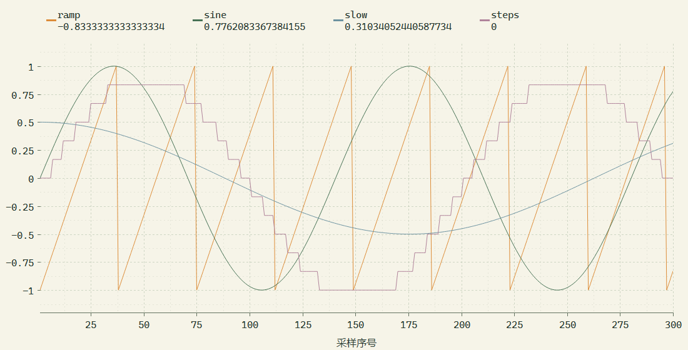
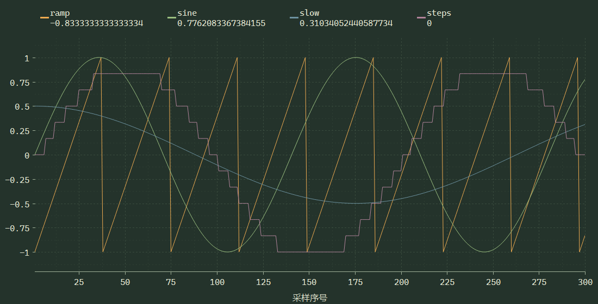
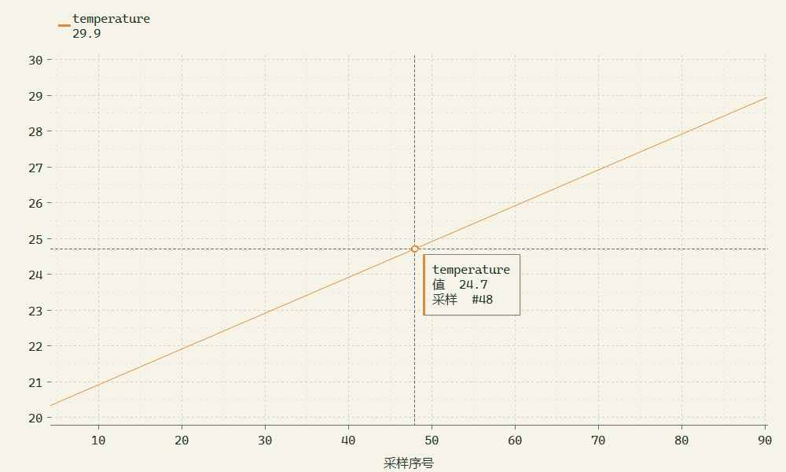
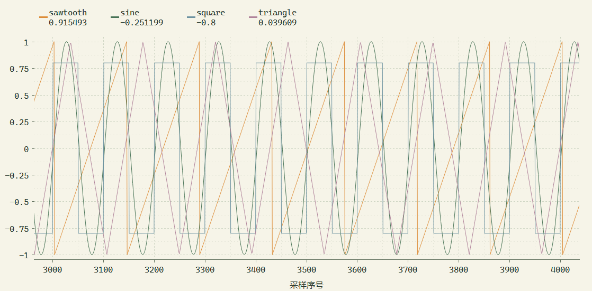
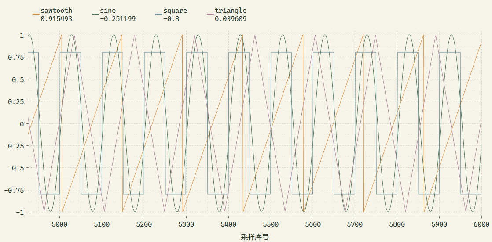
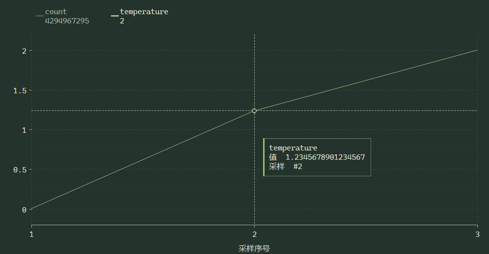

# 波形本地性能与读数验证

本地构建 0.15.5，基于 `codex/waveform-performance-readout`；本次未推送或发布 Release。协议仍为 wave/1。

## 测量结果

以下保留至 0.15.3 的绘制耗时记录。后续版本增加内置演示数据源并修正视图跟随逻辑；下表为历史密集绘制记录。

Windows 11、Qt 6.11.1、MinGW 13.1、Release 构建。相同诊断场景：1280 × 800 的波形控件页面，16 通道，每通道保留 5000 点；预填充后每轮追加一帧，测量数据同步及 `plot->grab()`，共 90 轮。

| 指标 | 修改前 | 0.15.1（关闭曲线抗锯齿） | 0.15.2（平滑曲线） | 0.15.3（主次网格） |
| --- | ---: | ---: | ---: | ---: |
| 平均同步与绘制耗时 | 989.504 ms | 5.323 ms | 6.417 ms | 7.508 ms |
| P95 耗时 | 1004.167 ms | 7.032 ms | 7.559 ms | 8.561 ms |
| 数据同步平均耗时 | 未单独记录 | 0.229 ms | 0.193 ms | 0.193 ms |
| 原始保留点数 | 80000 | 80000 | 80000 | 80000 |
| 最后一帧实际绘制顶点 | 未单独记录 | 36880 | 36880 | 36432 |

以上使用 Qt offscreen 平台测量，包含 QWidget 抓图开销，不能等同于显示器实测 FPS。波形页使用独立 16 ms 精确定时器，实际帧率还取决于数据发送周期、系统调度、屏幕缩放及其他界面负载。

主要变化：增量获取采样，复用网格与曲线缓存，按屏幕列保留原始极值，曲线采用 Qt cosmetic 细线的快速抗锯齿绘制路径。文字与曲线均启用抗锯齿，曲线归并不改变原始数据或 MCP 输出；悬停检查直接查询原始采样。

## 内置演示数据

0.15.4 在波形页的数据来源选择器中增加「Demo · 演示波形」。选择后预填 500 个采样，以 20 ms 周期继续生成正弦波、三角波、方波和锯齿波。走同一套 wave/1 解析和绘制流程，多个控件及 MCP 可共享读取，不连接实体设备、不创建额外收发标签，发送操作被拒绝。控件页面恢复时可恢复 Demo 来源。

验证覆盖首次选择、数据持续增长、共享复用、切换到真实连接、只读限制、保存与恢复、停止及重新启用。0.15.5 增加独立的 JSON/XML Demo；两个控件页仅展示对应的内置 Demo，JSON/XML Demo 不产生波形采样。


## 缩放和平移

滚轮围绕鼠标缩放双轴，Shift 只缩放横轴，Ctrl 只缩放纵轴。直接在某个坐标轴上滚动也可单独缩放该轴。横轴刻度按窗口宽度和可见采样跨度选择整数间隔，纵轴使用清晰的 1 / 2 / 2.5 / 5 倍数刻度。

左键可自由拖动，完整历史也可平移。手动平移或横轴缩放后停止跟随新数据，继续接收不会推走当前范围；「跟随最新」只将当前窗口平移到最新采样，保持横轴跨度与纵轴范围；双击或「自动缩放」才恢复双轴完整范围和跟随。采样上限输入去掉「点」后缀。

0.15.3 参考用户提供的 VOFA+ 截图调整网格密度：主刻度按屏幕距离选择最接近的整洁间隔，主格中间增加次网格，主次虚线使用不同明度。数字只标在主刻度上；横轴按字宽避免标签重叠，窗口变宽时增加格数，变窄时减少标签，不改变原始采样值或可见数据范围。







## 跟随最新保持显示比例

0.15.5 覆盖横轴缩放后开启跟随、手动/自动纵轴状态、连续收到新采样、历史淘汰、取消与恢复跟随以及窗口调整。开启跟随时只将横轴右端移到最新采样，跨度保持原值，纵轴保留当前显示范围；自动缩放按钮仍可重新显示全部保留采样。





## 读数与回归

- 84 项原生用例、44 项脚本用例通过。
- Windows 原生窗口检查浅色/深色读数；最新值不省略，悬停显示原始通道、序号和精确值，Ctrl+C 可复制。
- 回归覆盖增量历史、来源移除、历史重置、旧通道退出后新通道进入、16 ms 定时器、隐藏/冻结停表、单点脉冲保留、大数值常量和拖动位移；覆盖鼠标锚点缩放、双轴独立缩放、完整历史平移、新数据到达时保持手动视图、双轴拖动期间接收新采样以及窗口缩放保持可见范围。
- 部署目录通过 HTTP / STDIO MCP 集成测试。单文件 EXE 与便携包通过独立运行库验证、Unicode 路径、首次/缓存启动、参数转发、运行库缓存修复及共享读取测试。
- 本轮未连接实体 COM 硬件；输入由软件回环及内置演示生成。




## 复现

开启 `BUILD_TESTING` 后构建 `wave_benchmark`。将当前 Qt 和编译器运行库加入 PATH，再运行：

```powershell
.\build\native-release\bin\wave_benchmark.exe build/wave-final.json -platform offscreen
```

结果写入 JSON；第二个位置参数可指定测量轮数，默认 90。诊断程序不加入 CTest 的耗时断言，避免不同机器性能影响功能测试。

设备每 500 ms 发送一条波形报文时，每秒只有 2 个新采样。希望曲线连续时，可单独把 `@wave` 报文调整为 10～20 ms 一次，日志及 JSON/XML 使用较慢周期，并核对总字节率是否符合实际串口吞吐。
