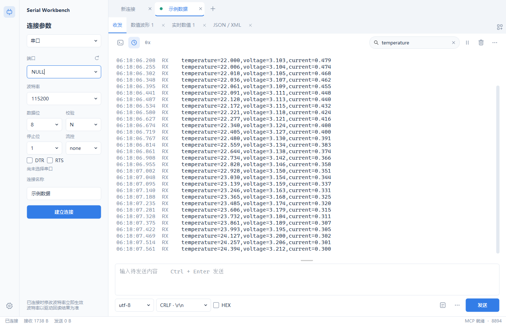
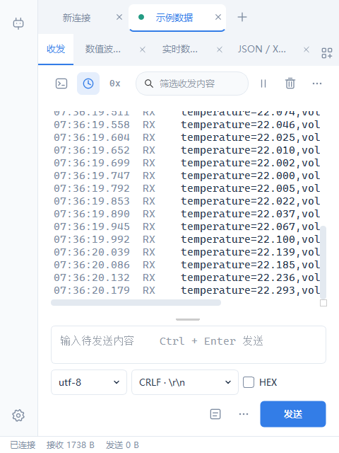
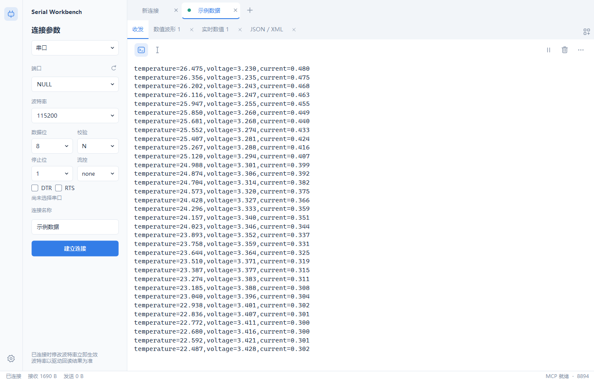

# 原生工作台 0.8.0 验证

验证日期：2026-10-12。Windows 11 x64，Qt 6.11.1 / MinGW 13.1 / C++17 Release。

分支：`feat/workspace-detachable-tabs`。运行入口仍为根目录 `start.bat` 或 `start-native.bat`，发布目录为 `dist/SerialWorkbenchNative/`。

## 界面与行为

- 左侧直接显示波特率、数据位、校验、停止位、流控及 DTR/RTS。连接期间修改会应用到原串口。
- 端口每秒扫描，列表变化时才更新；下拉列表打开时延后刷新，保留手动输入、选择位置和当前端口，不自动切换设备。
- 工具栏直接提供终端、时间戳、`0x`、搜索、暂停与清空。搜索框使用内嵌图标和垂直居中的清空按钮。
- 协议选择改为短淡入菜单；添加控件使用网格加号图标，保留图表和数据二级菜单。
- 日志与终端使用同一按钮；Insert 或光标按钮切换方块/竖线。Insert 不发送设备数据。
- 换行菜单同时显示转义字符、缩写和英文全称，实际发送仍按 None/LF/CR/CRLF 编码。
- 连接标签、收发/控件标签、设置标签均可拖出，也提供右键分离入口。标签可以排序。独立窗口关闭时返回标签栏，连接标签上的关闭按钮仍移除连接。
- 分离保留原 Pane、Channel、连接 ID、发送草稿、解析器和共享历史。原连接切换到后台后，独立波形、解析和收发窗口继续更新；主窗口退出时统一保存和关闭。
- 宽窗口发送选项保持单行，窄窗口分成两行。最小主窗口宽度为 480 个 Qt 逻辑像素，窄窗自动收起参数侧栏，可用左上角图标展开。

## Windows 11 窗口布局

独立窗口保留原生标题栏、最大化按钮和可调边框；拖出时调用 Qt `QWindow::startSystemMove()`，标题栏拖动、吸附与布局由系统处理。独立窗口标题栏拖回原标签栏可以重新停靠；连接窗口也可返回其他连接窗口的标签栏。

[Microsoft 的 Snap Layouts 文档](https://learn.microsoft.com/en-us/windows/apps/desktop/modernize/ui/apply-snap-layout-menu) 说明原生最大化按钮会提供布局菜单，并建议最小宽度不超过 500 有效像素。[Qt 系统移动接口](https://doc.qt.io/qt-6/qwindow.html#startSystemMove) 将窗口拖动交给系统。

自动检查覆盖 Windows HWND 的 `WS_CAPTION`、`WS_MAXIMIZEBOX`、`WS_THICKFRAME` 和 480 宽度布局。系统 Snap 浮层和真实鼠标拖动吸附未作自动视觉验证；其显示还取决于 Windows 多任务设置及屏幕布局。

## 验证结果

- Release 编译成功。
- QtTest 在 offscreen 与 Windows 原生平台运行：12 个功能用例，含初始化和清理为 14 项，全部通过。
- 新增覆盖端口插拔列表变化、编辑内容保留、串口参数即时应用、搜索清空按钮定位、工具栏开关、Insert 不发送数据、换行字节、分离与返回、后台控件更新、草稿保留、多窗口关机保存、设置标签分离和原生窗口样式。
- 使用正常 Windows 用户桌面渲染工作台、搜索、终端、窄窗、协议菜单、分离窗口、波形、设置及深色主题截图。
- 发布包通过官方 MCP SDK 的 HTTP / 原生 STDIO 检查：9 个工具、共享会话、独立读取、权限、软件回环参数重配置、长轮询、波形、重连及输入校验。

本轮使用软件回环和真实 TCP / UDP sockets，没有主动打开实体 COM 设备。软件回环检查不代表实体 UART 线速验证。

